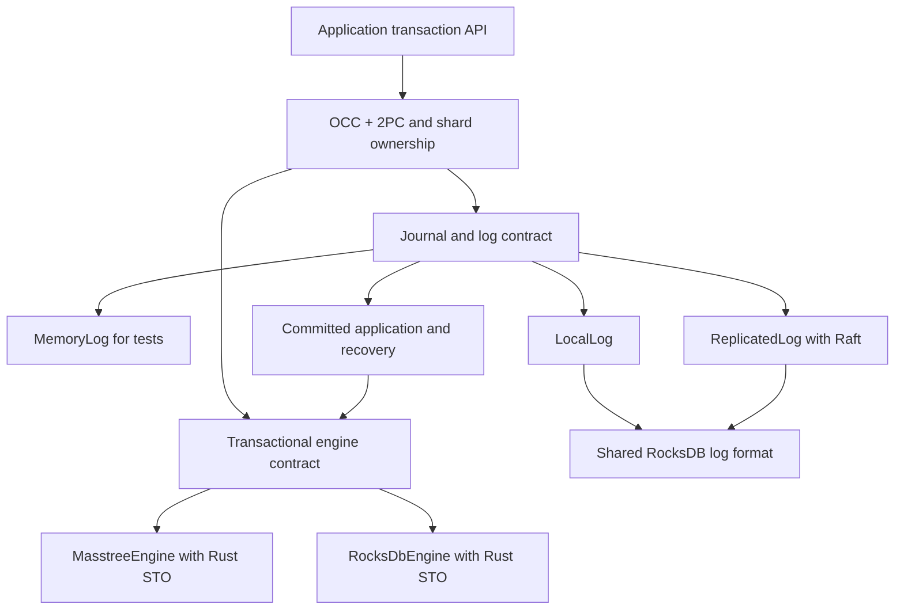

# Pluggable distributed transaction engines

Status: historical baseline, complete and qualified on `pluggable-distributed-engines`.
The [optional Masstree adjustment](rocksdb-optional-masstree.md) supersedes its
independent durability design with a common RocksDB final data store.
Executable implementation: `c79ba2617`. No push has been performed for this work.
Baseline: `mako-dev` at `2b0387b91`. Work is paced by the exit conditions below;
a passing intermediate stage does not mean the integration is complete.

The user approved this plan on 2026-11-25. Implement and qualify each stage,
commit reviewable results locally, and update the book as behavior changes.
Push is a separate action. Reuse the existing Rust STO adapters rather than
reimplementing their concurrency control.

Build one distributed transactional system with interchangeable data engines.
Applications choose Masstree or RocksDB for their committed key/value data,
independently of choosing local or Raft-replicated logging. Both engines reuse
Rust STO and the existing OCC + 2PC protocol.

For Masstree, RocksDB stores the transaction log, not a second authoritative
key/value database. Masstree recovers from a durable checkpoint and committed
log records. For RocksDB, committed keys and values live directly in RocksDB.
This separation is the objective; naming two implementations of an interface
without removing the mandatory RocksDB row mirror would not complete it.

This lets the same transaction, sharding and recovery protocol serve an
in-memory ordered engine and a persistent data engine. It also removes the
requirement to materialize Masstree data in two live stores. The main cost is
making application, prepared ownership and checkpoint recovery independent of
RocksDB's atomic row batches. Treat any throughput benefit as something to
measure after correctness, not a promise of this refactor.

## Target architecture

| Choice | Responsibility | Production implementations |
| --- | --- | --- |
| Data engine | Reads, private writes, locks, validation, committed data and application | MasstreeEngine or RocksDbEngine |
| Transaction log | Ordered authoritative records and their durability | LocalLog or ReplicatedLog |
| Distributed protocol | Global lock barrier, prepare votes, decision, completion and resolution | Existing Rust OCC + 2PC |

Support all four production combinations: each data engine with LocalLog or
ReplicatedLog. MemoryLog remains testing-only and advertises no restart
durability. A small model engine is a separate test dependency; MemoryLog is
not itself a data engine.

Select one data engine per shard. Initially all replicas of a Raft group use
the same engine and compatible format. Permit transactions spanning shards
with different engines once the mixed-engine contract tests pass. Changing an
existing shard's engine is a data conversion or migration operation, not a
configuration-only restart.

The first plugin interface covers ordered byte-key tables, point reads,
absence, writes, deletes and scans. Keep STO's datatype extensibility beneath
this boundary. Distributing arbitrary process-local STO objects would also
require serialization, ownership and recovery contracts and is a later extension.

## Existing code to reuse and separate

| Current implementation | Implication |
| --- | --- |
| [`mako-protocol`](../../crates/mako-protocol/src/lib.rs) and its verified core | Reuse the coordinator, journal transitions, identities and failure semantics. |
| [`sto-core`](../../crates/sto-core/src/lib.rs) | Reuse local concurrency control for both adapters; do not introduce another OCC algorithm. |
| Runtime [`storage.rs`](../../crates/mako-runtime/src/storage.rs), [`prepared.rs`](../../crates/mako-runtime/src/prepared.rs) and [`migration.rs`](../../crates/mako-runtime/src/migration.rs) | These bind directly to Masstree workers, tables and retained participants. Move those bindings into the Masstree adapter. |
| Runtime [`DurableRows`](../../crates/mako-runtime/src/durable.rs) and [`log.rs`](../../crates/mako-runtime/src/log.rs) | They combine persistent user rows, transaction state, receipts, applied position and Masstree replay. This is the main persistence coupling to remove. |
| [`sto-rocksdb`](../../crates/sto-rocksdb/src/transaction.rs) | Already supplies direct RocksDB data access using STO, with write locking separated from certification. Extend its retained participant and recovery lifecycle for distributed 2PC. |
| [`rocksdb-raft-service`](../../crates/rocksdb-raft-service/src/lib.rs) | Reuse adapter/process experience. Its existing local-transaction service is not the distributed coordinator to extend independently. |
| [`mako-engine-api`](../../crates/mako-engine-api/src/engine.rs) | Its existing interface is shaped around the cache and specialized publication paths. Do not make plugins implement those unrelated methods. |

Introduce a small backend-independent `mako-storage-api` contract and adapters
`mako-storage-masstree` and `mako-storage-rocksdb`, wrapping existing storage
code. The contract crate must not depend on either native backend, SRPC or Raft.
Use associated types or an enum selected when a worker is created; preserve
affine transaction ownership rather than sending borrowed frames across threads.

## Engine contract

Specify semantics before fixing exact Rust signatures. Separate the transaction
interface from committed application, recovery and migration operations.

| Operation group | Required guarantee |
| --- | --- |
| Begin and execute | Committed reads plus the transaction's own staged writes; execution records point, absence and range dependencies. No speculative publication. |
| Lock | Freeze the write set and retain all required write/predicate protection. Return the read-dependency information required by the distributed timestamp protocol. |
| Validate and seal | Final validation occurs only after every participant reports its write locks acquired. Produce owned, immutable, backend-independent intent. |
| Retain and resolve | A service owns prepared work across listener teardown, retries and lost replies. Only the saved coordinator decision can finish it. |
| Apply | Publish a complete committed effect and its logical application metadata atomically to admitted readers. Repeated application is idempotent; changed bytes at an existing identity are rejected. |
| Recover | Restore committed data and unresolved prepares, or fence admission. Never reconstruct an uncertain outcome as Abort. |
| Checkpoint and transfer | Export an exact application cut with versions, tombstones, protocol state and ownership identity; validate before publication. |

Represent a key's application timestamp separately from its backend conflict
token and the log's index/term. In particular, RocksDB's existing local generation
must not be truncated or treated as the distributed `time_term`. Add the logical
version metadata needed to preserve the same read-dependency rules as Masstree.

Preserve absence and phantom protection, including paginated scans and deletes.
A snapshot alone is insufficient conflict validation: RocksDB documents that a
read snapshot chooses the data version without deciding whether a transaction
can commit. Retain the STO adapter's explicit validation and range protection.
[RocksDB transaction documentation](https://github.com/meta/rocksdb/wiki/Transactions#repeatable-read).

All mutations, including loading, replay and migration, must update the engine's
conflict metadata through controlled entry points. Exposing RocksDB directly as
the data engine does not permit untracked writes behind the transaction manager.
Capability and size-limit mismatches must fail before an attempt becomes prepared.

## Separate the log from the materialized state

Keep `MemoryLog`, `LocalLog` and `ReplicatedLog` and the shared RocksDB log
format. Refactor their application binding to accept an engine-neutral state
machine instead of requiring `DurableRows`. Preserve `Begin`, `Prepare`,
`Decide` and `Complete` and their immutable identities.

Separate three things currently bundled together: the authoritative command
log, the derived transaction/receipt index, and the committed data engine.
The application index includes unresolved intent, decisions, completion receipts,
replay fingerprints and applied progress. It must be recoverable together with
the engine state. It is not an excuse to retain a hidden RocksDB copy of every
Masstree row.

The completion order remains:

1. Acquire write locks at every participant, then validate reads and predicates.
2. Save each participant's Prepare before returning Yes.
3. Save one coordinator decision through its selected log.
4. Save and apply each participant's Complete; publish rows only for Commit.
5. Acknowledge completion after the engine and application index have reached
   the required position. If application fails after a durable decision, fence
   and recover rather than returning an ordinary abort.

Raft commitment and a distributed transaction's Commit decision are distinct.
A committed Raft Prepare entry still represents invisible prepared intent.
Followers apply logged effects; they never rerun client transaction bodies or
independently decide whether a globally committed transaction should abort.

### Masstree data path

Serve committed keys and values only from Masstree. Durability comes from the
selected log and checkpoints. The application journal/index can live in memory
and be reconstructed from those artifacts. There is no mandatory `rows` RocksDB
database and no fallback point lookup into RocksDB.

On restart, load the last fully published checkpoint, replay the committed log
suffix and restore prepared protection before admitting traffic. Until checkpointing
is implemented, retain the entire required log and replay from its beginning.
Values inside redo records and checkpoint files are expected recovery data;
they are not a second live key/value engine.

A persisted applied counter cannot prove that volatile Masstree rows survived.
Recovery must start from the checkpoint's recoverable position, not a newer
metadata counter left by the previous process. Likewise, applying several rows
and then recording completion must not expose a partial transaction. Use retained
STO protection for local participants and an explicit publication/admission gate
for replay and follower application.

### Direct RocksDB data path

Use `sto-rocksdb` for committed user data, snapshots and STO conflict protection.
Integrate it with the same distributed participant service. Extend the local
Prepared lifecycle so a saved distributed Prepare can retain its protection
until either authoritative Commit or Abort; local Raft submission is not a
substitute for that distinction.

Store changed rows, versions, application journal updates, receipts and applied
position in one atomic data-store batch. Keep the command log logically separate.
There is no atomic write spanning two RocksDB instances: persist the authoritative
log first, then apply to the data store, with idempotent recovery of the gap.
Do not invoke another conflict-checking commit after the distributed Commit
decision has become irreversible. Storage I/O can still fail and must fence.

## Checkpoints and log retention

Define a versioned logical checkpoint containing schema and engine identity,
log position, committed rows with versions/tombstones, unresolved prepares,
decisions, retained receipts and routing/ownership state. Start with an explicit
pause at an exact application boundary and measure its duration; optimize
checkpoint concurrency later.
Do not wait indefinitely for prepared transactions to resolve: include their
durable intent and restore protection before admission.

Publish checkpoints with checksums and durable manifest replacement. Restore
into a new generation, validate it, and activate it only when complete. Trim a
log prefix only after a durable checkpoint covers all state and references
needed for recovery, and after satisfying the Raft snapshot rules where applicable.
This also supplies the missing local-log checkpoint/compaction path.

RocksDB's existing native checkpoint will be reused as its backend artifact; it
does not by itself coordinate separate application and log databases.
[RocksDB checkpoint documentation](https://github.com/meta/rocksdb/wiki/Checkpoints).

Keep protocol-record retention separate from physical log trimming. A checkpoint
must retain unresolved intent and decisions/receipts required by delayed requests.
Do not add terminal transaction garbage collection without its own stale-request
fence and cross-participant safety argument.

## Implementation stages

Completed on 2026-11-25:

- The neutral engine API, model conformance and explicit Masstree/RocksDB adapters
  are connected to the distributed participant and client paths. Neither the
  upper protocol nor its proof gate depends on a native backend.
- Masstree recovers from checksummed checkpoints and committed log replay without
  a RocksDB row mirror. Checkpoints cover pending prepares and saved Complete
  effects awaiting affine installation. Local/Raft prefix trimming and artifact
  retention preserve recovery authority.
- Direct RocksDB uses STO conflict protection and the same OCC + 2PC protocol,
  with atomic row/version/protocol/progress application. All four engine/log
  combinations and transactions across engines are qualified.
- Durable sharding/migration stores control state behind the selected engine and
  log. Recovery restores locks and epoch pins before admission, rebuilds drain
  cuts, preserves saved decisions and binds row/control work to log authority.
  Local and replicated crash/retry scenarios pass, including mixed engines.
- `mako_convert` imports shared-log legacy row mirrors and converts between both
  current engines. It preserves tombstones, receipts, prepares and Raft authority
  including uncommitted suffixes. Real node tests cover conversion, recovered
  migration control and distinct shard/Raft-group identities. Existing targets
  and live sources are rejected. Retired segmented WALs, missing log authority
  and changing migration schema require separate format/authority work.
- Final qualification passed 83 debug runtime cases, 80 release cases, 22
  RocksDB-only cases, 18 cases each under ASan and TSan, strict Clippy/doctests,
  component suites and both build audits. The upper gate passed in 175.663
  seconds on 32 CPUs with all 25 semantic negative controls. The native audit
  covers 13 production links and 47 Rust archives; the RocksDB-only audit covers
  all seven executables without Masstree. No performance campaign was run.

The [qualification record](../testing/pluggable-engines-2026-11-25/README.md)
indexes the final and intermediate evidence, trusted adapter obligations and
operational limits. All stages below were committed locally as reviewable work.

Each stage should produce reviewable commits and pass its checks before the next
stage expands the supported configuration matrix.

| Stage | Work | Exit condition |
| --- | --- | --- |
| 1. Contracts and model engine | Add the neutral API, ownership/error contracts, model engine and reusable conformance scenarios. Define the logical checkpoint and replay invariants. | Upper tests and Verus targets run with no native dependencies; meaningful negative controls reject violations. |
| 2. Extract the Masstree adapter | Move concrete workers, tables, participant retention and storage verbs behind the API. Remove Masstree worker types from the common client/server interface. Temporarily preserve existing persistence behavior. | Existing runtime/application tests pass through the adapter; the common API and protocol compile without Masstree. |
| 3. Independent Masstree durability | Replace the compulsory DurableRows binding with the engine-neutral state machine. Implement log replay, checkpoint publication and safe retention. | Local and Raft Masstree nodes restart and recover without any RocksDB user-row database. Pending prepares, tombstones and receipts survive. |
| 4. Distributed RocksDB adapter | Adapt STO locking/certification, logical versions, retained 2PC and atomic data/index application. Route it through the common coordinator and wire protocol. | Cross-shard transactions and crash recovery pass with direct RocksDB data and no linked Masstree. |
| 5. Cross-backend conformance | Run both engines with both production logs; run transactions across Masstree and RocksDB shards. Test authority changes and delayed/duplicate decisions. | The same contract suite passes across the matrix; client code and transaction semantics are unchanged by engine selection. |
| 6. Sharding and migration | Implement versioned range export/import through the engine contract. Preserve drain, prepared ownership, tombstones, pagination and old-owner fencing. Add durable handoff/recovery for local and replicated shards. | Migration crash/retry and stale-owner controls pass on both engines, including cross-engine transfer. Unsupported combinations remain rejected until this gate passes. |
| 7. Conversion and release | Add explicit engine/log configuration, build profiles, offline data conversion, book/API examples and qualification evidence. Remove the temporary persistence bridge from production selection. | Both engine modes are usable through one application API, with documented recovery and no hidden data-engine fallback. |

Stages 1–5 deliver pluggable distributed transactions with fixed shard placement.
Stage 6 adds durable/replicated migration and has its own recovery and crash gate.
Do not report the full plan complete before conversion and release qualification.

The recovery implementation reuses `DurableParticipant` and `DurableCoordinator`.
The older inspection-only metadata reader does not become an authority.
Control metadata must live behind the same selected log as row effects, in a
reserved internal table/namespace covered by engine checkpoints. The host must
restore retained transaction protection before reopening ordinary admission;
a process restart cannot reuse an old in-memory drain epoch as evidence. Copy
and cleanup resume against actual committed rows and immutable saved plans.
A completion receipt is saved only after its row barrier succeeds. Replicated
migration additionally needs authority checks, actor reconstruction after a
leader change, and peer discovery through the replica group. These are required
parts of durable integration; the storage trait alone does not provide them.

For conversion, quiesce the old shard, resolve or explicitly preserve prepared
work, and export an exact logical checkpoint from existing rows and journal
state. Initialize the new engine generation with matching log authority and
verify it before activation. Existing Raft logs may have compacted history into
RocksDB checkpoints, so deleting the old row store and replaying only the current
log is unsafe. Preserve the old generation until conversion is verified; engine
and format mismatches fail closed. Mixed-version rolling conversion is outside
the first release.

## Verification and test organization

Keep the everyday upper gate under five minutes on the recorded CPU budget,
targeting the current two-to-three-minute range. Use the model engine, fake
delivery and MemoryLog for deterministic protocol tests. Run the production
Verus cores and semantic negative controls; do not put native backend suites
into that gate or run performance tests on every edit.

For durable crash simulations, use a model log with explicit persistence and
crash transitions. Do not change MemoryLog to claim durability that it lacks.

Extend proof obligations for recoverable application progress, checkpoint
publication and safe trimming. Negative controls must catch advancing progress
without recoverable state, publishing Prepare as committed rows, dropping
unresolved intent, trimming before checkpoint publication and accepting an old
owner after handoff. State explicitly which adapter/storage properties remain
assumptions rather than claiming a proof of RocksDB or Masstree.

Run engine conformance tests separately against the model, Masstree and RocksDB:
point/absence/range conflicts, write skew, read-your-writes, insert/delete
semantics, byte ordering, frozen intent, retention and exactly-once logical
effects. Keep the existing independent STO, Masstree, RocksDB, SRPC and Raft
component suites.

Native integration adds the four production engine/log combinations and mixed
engine transactions. Inject failures before/after log commitment, during
multi-row application, at checkpoint publication/trimming, across prepared
restart and leader change, and during range handoff. Assert no partial visibility,
no forgotten acknowledged commit, no invented abort and no duplicated effect.
Model unsynced-write loss separately from process-kill tests, which do not alone
establish power-loss durability. Use the existing container and sanitizer gates
for changed native boundaries.

Build audits must show that a RocksDB data-engine process does not link Masstree.
Masstree recovery tests must inspect the data directory and require successful
recovery with only the log and checkpoint artifacts, not a hidden row database.
Performance remains weekly/manual, comparing latency, throughput, conflict
rates, replay/checkpoint cost and log growth under identical durability settings.

## Completion criteria

- An application chooses its data engine and logging policy independently and
  uses one distributed transaction API.
- Masstree serves data without a RocksDB key/value mirror and recovers from
  checkpoint plus log; RocksDB serves data without Masstree.
- Both preserve the global write-lock barrier, final read validation, durable
  prepare, immutable decision, atomic publication and unknown-outcome semantics.
- Restart, Raft failover, prepared recovery and the qualified migration modes
  work through the same contracts, with explicit format/engine fencing.
- The isolated upper gate remains fast; component, native, sanitizer and
  performance gates stay separate. The book, examples and evidence describe
  actual supported combinations.
