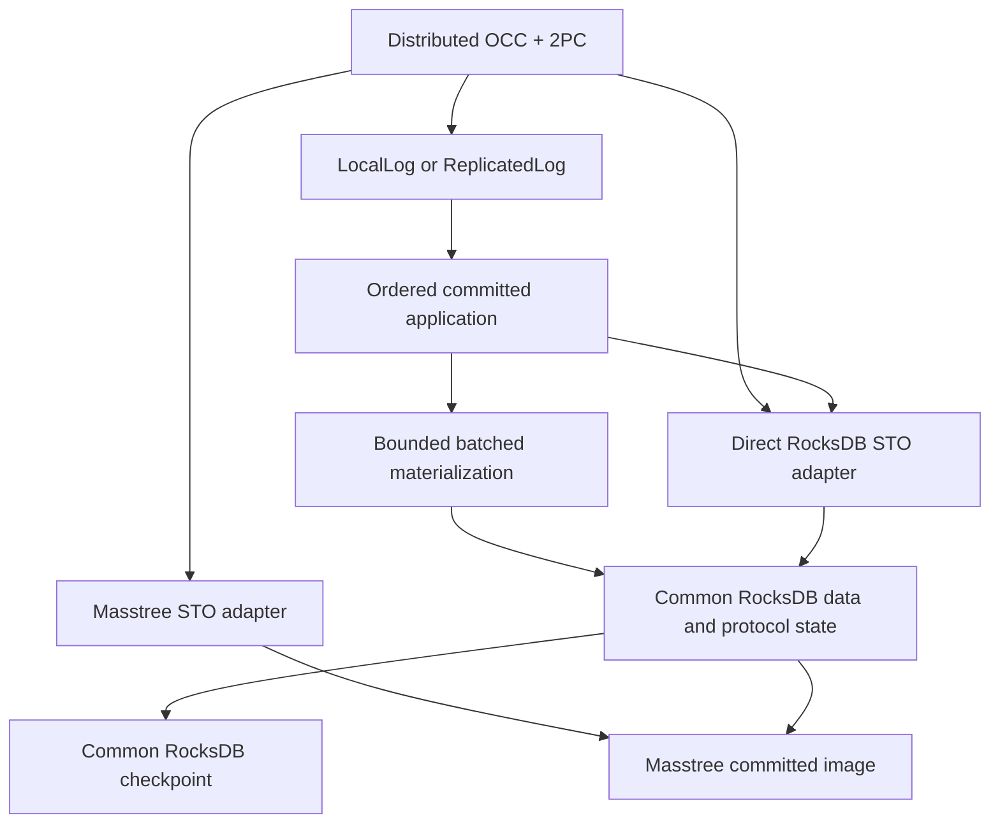

# RocksDB with optional Masstree transaction acceleration

Status: implementation in progress on `rocksdb-with-optional-masstree`.
Baseline: `d3981a858`. This adjustment supersedes the independent durable data
engines in the previous pluggable-engine plan. The user selected batched RocksDB
materialization for the Masstree path on 2026-11-25. Implement and qualify each
stage, update the book, and commit locally. Push is separate.

RocksDB is the final durable data destination in both production modes. The
application uses the same distributed transaction API, OCC + 2PC, sharding,
migration and local/Raft log interfaces. A configuration flag chooses the
transaction adapter and optional in-memory Masstree image.

## Data and transaction contracts

The direct path installs each decided command into RocksDB atomically with row
versions, tombstones, protocol metadata, replay identities and its applied
position. The Masstree path serves transactions using the existing affine STO
adapter. It saves decisions in the selected durable log, installs committed
rows in Masstree, and batches those same ordered effects into RocksDB. It never
reruns validation after Commit and never materializes Prepare as visible rows.

Track three positions: the committed log prefix C, the application prefix A,
and the RocksDB materialized prefix D. At observable application boundaries,
D <= A <= C. Direct application keeps D = A; Masstree may have D < A. RocksDB
always represents one exact prefix, including transaction state and receipts.
Its batch updates rows, metadata, all covered replay fingerprints and D in one
atomic write. A failed/ambiguous batch fences application rather than guessing
whether it happened.

Bound pending records and bytes. Flush on the size threshold, an idle timer,
checkpoint, and orderly shutdown. A flush uses the already decided log effects,
including Complete records whose affine installation is still pending. It does
not acquire a second set of transactional write locks or revalidate decisions.
The log covers a crash before materialization. Physical log trimming requires a
validated, durably published checkpoint covering the trimmed prefix.

Both modes use the existing distributed RocksDB profile and schema/owner
identity. Data ownership uses the shard ID; Raft membership uses its separate
group and replica IDs. Enabling Masstree does not change either identity, the
command format, the data directory or the native checkpoint format.

## Recovery and mode switching

On startup, validate the common RocksDB image against the selected log. The
direct adapter loads its protocol index and replays the missing committed suffix.
The Masstree adapter rebuilds RAM from the RocksDB image, then replays that same
suffix. Restore unresolved prepare protection, migration pins and control state
before opening admission. A previous RAM position is never recovery authority.

A checkpoint first materializes through its exact application cut, then uses
RocksDB's native checkpoint and the existing host publication protocol. Both
modes can restore the resulting artifact. If an incoming checkpoint replaces a
lagging replica's base, discard superseded buffered effects and reconstruct the
Masstree state before admitting requests.

The recommended configuration is the same `engine.kind: rocksdb` and data
`directory`, with `masstree: false` or `true`. A restart applies the toggle;
there is no data conversion between these two modes. Keep the old `kind:
masstree` spelling as a compatibility shorthand with a derived RocksDB data
path. Missing stores and old file-only checkpoints must never be silently
opened as empty data. The offline converter imports the old logical checkpoints
or `DurableRows` format into the common RocksDB format. Its output always has
RocksDB data regardless of which transaction adapter is selected.

Initially Masstree holds the complete committed image in RAM. This work does
not add eviction, lazy cache misses or an in-process live toggle. Replica mode
may differ within one group once the mixed-mode failover/snapshot test passes;
all replicas still use compatible code, schema and checkpoint formats.
MemoryLog and bare volatile engines remain testing-only.

## Implementation stages and exit conditions

| Stage | Work | Exit condition |
| --- | --- | --- |
| 1. Shared materialization contract | Extend the storage API for bounded ordered atomic batches and paged durable export. Reuse the direct RocksDB format. Add materialization/recovery policy proofs and negative controls. | Component tests reject gaps, changed identities and partial batch state; the model/proof target has no native dependencies. |
| 2. Masstree above RocksDB | Queue committed effects, flush by count/bytes/timer, rebuild RAM from RocksDB, and flush the exact cut before native checkpoint publication. Fence errors and join background ownership on shutdown. | Acknowledged writes and unresolved prepares survive crashes before/after materialization; data eventually reaches RocksDB without a user checkpoint call. |
| 3. Configuration and upgrade | Add the restart toggle with the same data/log directories, keep explicit old-format refusal, and update the converter to emit common RocksDB state. | Switching both ways needs only a configuration change; no new database, copying or conversion is required. Old file-only images have an explicit tested upgrade path. |
| 4. Integration matrix | Exercise LocalLog and Raft, mode switches, mixed replicas, checkpoint transfer, prepares/receipts/tombstones, and durable migration across recovery. | The common API and ownership semantics hold in both modes and through switching. |
| 5. Documentation and qualification | Update the book, examples and build profiles. Run isolated upper verification, component/native/release tests, focused sanitizers and dependency audits. | Upper verification finishes within five minutes; RocksDB-only builds exclude Masstree; all required gates pass with reviewable evidence. |

Keep upper protocol tests separate from Masstree/RocksDB, SRPC and Raft component
suites. Add only meaningful regressions for the changed durability boundary.
Performance campaigns remain weekly/manual; no throughput claim follows from
this architecture change. Native batch atomicity, filesystem durability,
serialization and restoration of physical protection remain trusted adapter
obligations exercised separately from the Verus policy proofs.

## Completion criteria

- Both production modes end in the same RocksDB data and checkpoint format.
- The Masstree path batches materialization while the durable log covers the gap.
- A configuration-only restart can enable or disable Masstree over existing data.
- Crash, replay, checkpoint, prepared ownership, receipts and durable migration
  preserve the existing OCC + 2PC guarantees.
- Existing file-only Masstree directories have a qualified offline upgrade path.
- The book, examples, upper verification and separate native/build gates describe
  and qualify the actual final implementation.
