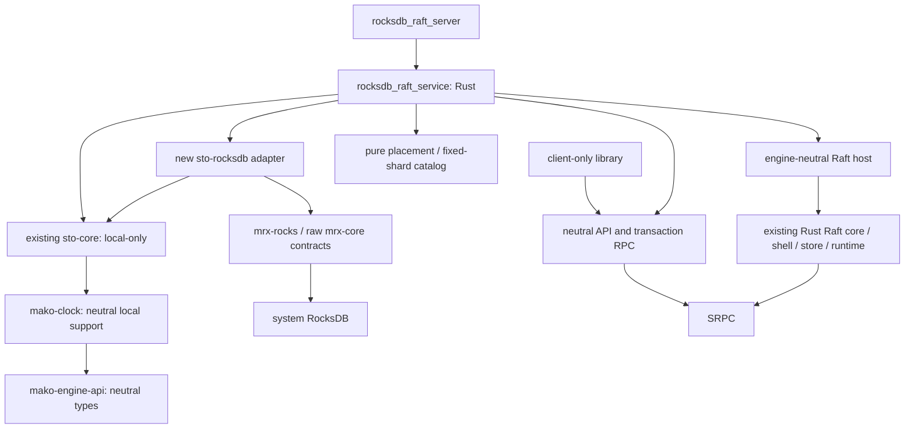

# Plan: Rust STO with a direct RocksDB backend and Raft

**Status:** implemented and Docker-qualified in the feature worktree, including
the original 80-case matrices, a paired 160-case sync/async SSD comparison, and
separate CPU/durability profiles. Async is opt-in and not power-crash durable.

**Baseline:** `mako-dev` at `9d6ec98b6`, after the Rust Raft and native Rust
sharding changes. Development branch: `codex/rocksdb-raft-mode`.

## 1. Goal and scope

Add a production build profile that is a **sharded RocksDB service with Raft
replication and optimistic transactions confined to one shard-local user DB**.
Keep the existing Mako profile as the default.

In the new profile:

- RocksDB is the primary data store, not a persistence sink behind another engine.
- Reuse the existing native Rust `sto-core` with a new `sto-rocksdb` adapter.
  Do not create a second optimistic transaction engine.
- Exclude C++ STO/MassTrans, `sto-masstree`, Masstree, the Mako value cache and
  writeback pipeline, Silo allocator/RCU/runtime, distributed/speculative Mako
  execution, Paxos, and the legacy log/replay pipeline.
- Each logical shard has one user RocksDB instance and one Raft group. A process
  may host several independent shards. Several tables in one instance may
  participate in a transaction; two instances may not, even in the same process.
- Rust STO owns transaction items, observations, intents, locks, validation, and
  cleanup. The service adds shard admission and Raft decision/application
  coordination around that core; it does not duplicate its read/write sets.
- Leaders execute client transactions against local RocksDB snapshots and
  STO-owned deferred intents. Followers apply committed transaction logs to their
  local RocksDB. There is no second cache of database values.
- By default, success means durable Raft quorum commitment **and** successful
  local application, not acceptance into a submission queue.

Not part of this feature: cross-shard transactions/2PC, speculative visibility,
Paxos in the new profile, online shard migration/split/merge, or a new Raft
consensus algorithm. Existing Mako functionality remains available in its profile.
Fixed placement plus Raft leader failover is sufficient for the requested
sharded service; current non-replicated Mako migration is not silently enabled.

The opt-in [async durability experiment](../rocksdb_interface.md#durability-selection)
retains the same engine, WAL logging, isolation and replication order but removes
foreground commit/log sync waits. It explicitly does **not** promise survival of
acknowledged data or consensus state after machine/power failure. Unless noted
otherwise, the durable protocol and failure guarantees below describe the default
sync policy. Async is not group commit, a cache-backed acknowledgment path, or a
change to the default Mako profile.

## 2. Decision: reuse Rust STO, replace its storage adapter

Use the Rust STO implementation already integrated in the local
`worktree-masstree-rocks` working tree. Its backend-independent core is
`crates/sto-core`; its existing Masstree implementation is a separate adapter.
Add `crates/sto-rocksdb` as another datatype/storage adapter to that same core.

**Rust STO owns concurrency control; RocksDB owns committed data; Raft owns the
replicated commit decision.** The existing `mrx-rocks` raw byte-store wrapper is
the starting native boundary, not the `mako-cache` writeback engine.

This supersedes the previous proposal to remove all STO and implement a new
coordinator. It also resolves the earlier choice between a custom coordinator
and stock `OptimisticTransactionDB`: reuse Rust STO, not two independent OCC
engines layered on top of each other.

Keep the RocksDB-like transaction programming model. This does not promise ABI
compatibility with every upstream RocksDB transaction method or reuse of
`OptimisticTransactionDB::Commit()`. One transaction still touches one user DB;
there is no distributed transaction protocol in the new profile.

### Why local native commit followed by Raft is insufficient

A throwaway probe was run inside `localhost/mako-build:verified-sharding` against
**RocksDB 8.9.1**, the Docker library actually used for this investigation:

| Operation | Observed result |
|---|---|
| Optimistic transaction `Prepare()` | `Invalid argument: Two phase commit not supported for optimistic transactions.` |
| `Commit()`, followed by `Rollback()` | Rollback returns OK, but the committed value remains visible. |
| `GetForUpdate()` at a snapshot, conflicting transaction commits, then original `Commit()` | Original commit returns `Resource busy`; its other write is absent. |

Consequently, native commit is not a reversible validation step. If it precedes
Raft and the leader fails, an unreplicated write can remain visible/durable. If it
follows Raft without an earlier conflict guarantee, it can reject a transaction
whose write log is already committed.

The Rust STO integration must therefore expose a real retained local commit
boundary and a fallible whole-transaction storage boundary. Its current
`CommitHook` is not a place to hide network waits or disk writes; §6 specifies
the required extensions and their failure semantics.

## 3. What exists today, and what must change

| Existing component | Evidence and implication |
|---|---|
| RocksDB-like facade | [`db.hh`](../../src/rocks_interface/db.hh) includes Mako storage/benchmark initialization; `Open()` initializes the Mako environment and `Commit()` calls `abstract_db::commit_txn`. Selecting this facade does not select RocksDB storage. |
| Common API | [`idb.hh`](../../src/rocks_interface/idb.hh) uses opaque `void*` transaction handles and a `void Commit()`. The new mode needs owned transaction contexts and a result that can distinguish commit, conflict, and unknown outcome. |
| Remote gateway | [`gateway_protocol.h`](../../src/rocks_interface/gateway_protocol.h) and [`remote_db.hh`](../../src/rocks_interface/remote_db.hh) explicitly describe independently committed operations. Sessions cannot be reused as atomic multi-operation transactions. |
| Build graph | [`CMakeLists.txt`](../../CMakeLists.txt) unconditionally creates Mako/Masstree components; `add_apps()` pulls in the engine and benchmark dependency bundle. `MAKO_USE_RAFT` does not remove Paxos or Mako. |
| Raft implementation | [`core`](../../src/deptran/raft/core) is generic Rust. The production shell/runtime still use Mako-facing command, configuration, and callback bridges. Existing standalone Raft drivers still link `mako`. |
| Raft persistence | [`store`](../../src/deptran/raft/store) persists consensus metadata/log checkpoints. Its RocksDB is not the user-row database. Its WAL-fold worker is not transaction replay. |
| Routing and migration | [`native_sharding.h`](../../src/cluster/native_sharding.h) and [`native_sharding_storage.cc`](../../src/mako/native_sharding_storage.cc) bind live admission/storage to STO epochs and MBTA. Pure placement logic is reusable; this embedding is not. |

The original Silo transaction engine is already retired. The component to make
optional here is the still-live Silo allocator/RCU/Masstree support, not a
resurrection or replacement of the retired engine.

### Rust STO source provenance

The implementation located for reuse is **the combined working tree**, not just
the older standalone branch:

| Source | Identity | Use |
|---|---|---|
| Combined worktree | `.claude/worktrees/masstree-rocks`, branch `worktree-masstree-rocks`, HEAD `d16184fdb2bc540a8357cc98c383369824da875e` **plus local changes** | Reuse baseline after a reviewed source snapshot |
| Original Rust STO worktree | `.claude/worktrees/sto-rust`, branch `codex/sto-rust`, HEAD `b8618722f1e6ad83b434058d046ba24896b49ed1` | Provenance/reference, not a replacement for the combined implementation |
| Recorded integration | `7de836393c1278a25797c6f28df689bff8d3d9f9`, “Merge codex/sto-rust: native Rust STO alongside the Rust transaction cache” | Confirms that combining the two projects is not new work |

The selected implementation/documentation paths contain **49 tracked changes**
and additional untracked sources. Examples under `crates/` include `sto-core/src/object.rs`,
`trans_item.rs`, `ordinary_protocol.rs`, `participant.rs`, and
`mako-clock/src/distributed.rs`; the old `adapter.rs` and `item.rs` are deleted.
The API names below describe those working sources, **not an attested API at
the HEAD commit**. A HEAD checkout or tracked diff alone would miss required
files. Do not overwrite, reset, or automatically commit that worktree.

The modified and untracked combined sources were captured without changing that
worktree or its index. The reproducible snapshot is
`4f04db97c36becd50b5b6ec288985b65da54a11b`, retained by local ref
`codex/rocksdb-raft-sto-source`. `crates/sto-reuse-source.json` records the
provenance. The feature imports `sto-core`, `mako-clock`, `mako-engine-api`,
`mrx-core`, `mrx-rocks`, `sto-test-datatypes`, `mako-history` and
`mako-differential`; it does not merge the cache branch wholesale.

There is one canonical `crates/sto-core`, extended with the retained local commit
API and default-preserving feature gates. The inventory below remains the
reuse/exclusion contract; imported packages now live in this feature worktree.

### Reuse / adapt / exclude inventory

| Component | Decision and actual boundary |
|---|---|
| `crates/sto-core` | **Reuse.** `Runtime`, `WorkerContext`, `Transaction`, `RegisteredResource`, `TransProxy`, `object::TObject`, lock plans, observations/intents, predicate validation, cleanup and outcome handling. Extend its phase machinery, not a parallel validator. |
| `crates/mako-clock` and `crates/mako-engine-api` | **Retain required neutral dependencies.** Current graph is `sto-core → mako-clock → mako-engine-api`; the API crate has no dependencies. Their names do not imply a value cache or native Mako linkage. Gate distributed-only surfaces. |
| `crates/mrx-rocks` and the byte-store contracts in `crates/mrx-core` | **Reuse and extend.** `RocksBlobs`, `Blobs`, `BlobOp`, and `Durability` supply raw bytes and atomic batches against system RocksDB. Add the missing snapshot/reverse-iteration/checkpoint/recovery operations; isolate cache-only helpers where necessary. Do not duplicate their FFI in a new wrapper. |
| `crates/sto-masstree` | **Exclude from the new runtime.** Reference for adapter semantics/tests, not an adapter base: it owns Masstree indexing and committed value/tombstone snapshots. |
| `crates/mako-engine-sto` | **Exclude from the new runtime.** Despite its name, it unconditionally depends on `sto-masstree` and `masstree`; selecting it is not a direct RocksDB backend. |
| `crates/mako-engine`, unchanged | **Do not select.** Its `sto` feature selects `mako-engine-sto`; its default selects the C ABI engine. Neither gives the required dependency closure. |
| `mako-cache`, `mako-local`, `mako-local-sys`, `masstree`, `mtree-sys`, and the cache/FFI umbrella crates | **Exclude.** No foreground cache ACK, delayed RocksDB writeback, native Masstree directory, or C++ STO bridge. |
| `sto-test-datatypes`, `mako-history`, selected differential corpus | **Test references.** Reuse adapter examples and history checking without making their in-memory value containers a production backend or faking cache-holder interfaces. |

Current source interfaces differ from the standalone branch:
`object::TObject`/`TransProxy`/`Cleanup*`/`LockContext` replace the older
`adapter::TransactionalResource`/`Entry`/`Finish*`/`PreflightContext` design.
Use the reviewed combined API, not a mixture of the two.

The `mako-engine-api` `LocalEngine`/`EngineDb`/`EngineTransaction` facade also has
cache-holder, arena and terminal requirements. Retain neutral types needed by
the clock/core, but do not force the direct backend to implement fake holders or
no-op cache operations. Its public storage facade should drive `sto-rocksdb` and
the core directly, or share an explicitly narrowed common interface.

Relevant combined sources are `crates/sto-core/src/{object,transaction,trans_item,
lock,hook,ordinary_protocol,participant}.rs`, `crates/mrx-rocks/src/lib.rs`, and
`docs/architecture/rust-sto.md`. The cache integration plan and its recorded
benchmarks concern a **Masstree-backed** Rust engine; they are not evidence of
direct RocksDB transactions or Raft durability.

## 4. Build and dependency design

Use one supported product-profile selector rather than an exponential set of
independent engine switches:

| Proposed `MAKO_BUILD_PROFILE` | Included | Excluded |
|---|---|---|
| `MAKO` — default | Current STO/MassTrans + Masstree + Silo support, Mako applications, existing replication choices | No change to current defaults |
| `ROCKSDB_RAFT` | Local-only Rust `sto-core`, `sto-rocksdb`, raw RocksDB storage, durable Raft, SRPC, neutral client/API, fixed-shard routing | C++ STO/MassTrans, Rust Masstree adapter, Mako cache/writeback, Silo support, distributed transaction paths, Paxos |

Rust STO stays **enabled** in the new profile. Masstree, the C++ engine, and Mako's
cache/distributed extensions are separate optional components—not prerequisites
of the Rust transaction core. Do not advertise arbitrary unsupported hybrid
Mako builds. Require durable Raft, one group per shard, and production mode.
Reject incompatible overrides rather than silently enabling an old engine.

Proposed target boundaries:



Required build changes:

1. Split neutral toolchain/SRPC flags from `BENCH_CXXFLAGS`, forced Masstree
   headers, C++ STO definitions, and benchmark include paths.
2. Gate Masstree configure/buildstamp/submodule handling, its subdirectory and
   tests, and C++ Mako allocator/RCU/STO source lists—not merely the final link
   line. Build the selected Rust core/adapter independently of those targets.
3. Extract neutral Raft payload/configuration/host kernels from the mixed
   `txlog_core` and helper machinery. Keep Mako watermark handling and Paxos
   dispatch in the Mako profile. Do not copy the consensus implementation.
4. Give the new executable a target helper that does not call the existing
   Mako-only `add_apps()` unchanged. Remove disabled components from `ALL`
   dependencies, including unrelated Redis builds and old application targets.
5. Gate direct DPDK, NUMA, jemalloc, protobuf, libevent, Python-development and
   benchmark-only dependencies where genuinely unused. Retain generation tools
   actually needed by SRPC/Raft. Packaged RocksDB may itself depend on libraries
   such as lz4/gflags; that is different from a direct Mako dependency.
6. Introduce an explicit RocksDB dependency target and report the selected
   header/library version. The repository currently installs an unpinned system
   package; the host's 9.10.0 must not stand in for Docker's 8.9.1 evidence.
7. Give each profile its own Docker build directory and suite/target list.
   Reject incompatible cache reuse. Preserve current default Docker commands.
8. Import the reviewed Rust STO/raw-store package closure into `crates/` and
   build explicit packages/features, not the full cache workspace or its native
   integration runner. `cargo check` alone is not proof of absent native linkage.
9. Add a default-preserving **distributed feature boundary** to the existing
   core/clock/shared types. The current code unconditionally exports
   `Participant`, `into_participant`, distributed install metadata, and
   `mako_clock::distributed`; there is no local-only feature today. Gate those
   paths and corresponding tests while retaining the same local item/lock engine.
   Disable defaults along every relevant dependency edge in the new profile and
   verify Cargo feature unification does not re-enable them. Merely passing
   `--no-default-features` to today's core does not accomplish this.

New logic is native Rust. Extend the reused `mrx-rocks` installed-C-API boundary;
[`rocks_metadata.rs`](../../src/cluster/rocks_metadata.rs) is an additional local
ownership/recovery reference, not a reason to create another wrapper. Use
narrow annotated C++ kernels only for required operations lacking a suitable C
API. Link one system RocksDB library, not a second vendored copy.

## 5. Storage and transaction contract

### Storage layout

Each shard owns:

- One **user** RocksDB DB with disjoint binary `data` and `meta` key namespaces.
  Logical tables have stable table-ID prefixes inside `data`; clients see their
  original keys and raw value bytes. One physical column family initially lets
  the existing `RocksBlobs::write_batch` atomically update both namespaces
  without introducing column-family DDL or a second storage wrapper.
- In `meta`: the table catalog and row counts, last-modified key versions,
  committed request outcomes, and the applied Raft position. Metadata is never
  exposed as user rows.
- The existing separate Raft WAL/base/snapshot storage under a different path.
  There may therefore be two physical RocksDB handles per group: the user DB and
  Raft's internal consensus base. “One local instance per transaction” refers to
  the user DB; merging those two durability domains is not part of this feature.

The transaction log is the versioned application record **inside Raft's log**.
Do not bring back the legacy C++ log packer, cache holder/Ready protocol, or
another authoritative log. RocksDB's application WAL protects its local batches.
Apply in committed Raft order—not the cache writeback pipeline's maximum-HLC
winner order or out-of-order worker-lane order.

### Transaction API

A transaction is bound at creation to one shard, one Rust STO runtime/store
lifetime, and an immutable routing/catalog view. Its actual `sto-core`
transaction owns the items, observations, and staged intents. A transaction-wide
owned RocksDB snapshot lease supplies committed reads. Read-your-writes comes
from the existing STO intents, not a second independently maintained write set.
Materialize the native batch once from sealed core-owned intents at the durable
commit boundary. Uncommitted values never enter a shared value cache.

| Surface | Contract in the new profile |
|---|---|
| Begin | Explicit shard, or resolve a routing key before opening; acquire a leader read barrier and a snapshot after application catches up. |
| Get / Exists | Snapshot plus own pending writes. Preserve the current facade's tracked-read OCC semantics, including observations that a key is absent. This is stronger than upstream's untracked plain `Transaction::Get()`. |
| Put / Delete | Stage raw bytes/tombstones locally; record the key's snapshot version for write-conflict validation. No replication or published write per operation. |
| Insert | Tracked absence check plus staged write; concurrent insert/delete/reinsert must not evade validation. |
| Scan / ReverseScan | Snapshot iteration merged with the core's staged-intent view, restricted to the bound shard/table/range. Validate a shard data-generation observation and conflict with pending shard writes. This conservatively catches phantoms without a range-lock engine. |
| Mutating Commit | Use Rust STO's lock/predicate/read validation, retain its sealed attempt through Raft decision, and return success only after quorum commitment and atomic application. Do not validate a second service-owned read set. |
| Read-only Commit | After the admission barrier, use the core's local read validation and close the attempt. Return the snapshot position; no extra transaction-log entry or durable write-outcome record is needed. Current commit hooks are skipped for read-only attempts, so the barrier cannot live solely in a hook. |
| Rollback | Discard an open, unproposed transaction. Once proposed, cancellation is not a promise of rollback. |
| Nontransactional writes | One-operation transactions through the same commit path, never direct raw DB writes. |
| Nontransactional reads | Leader barrier plus applied snapshot; not a raw stale local read. |
| Table creation/listing | Catalog is replicated; create-if-missing is an ordered, idempotent catalog command. Logical table IDs are stable across replicas/restart. |
| Approximate size | Read the table's row-count statistic maintained atomically on apply. Native per-column-family estimates cannot isolate a table prefix; do not return a DB-wide count or byte size instead. |

A request touching another shard poisons the whole transaction and returns a
specific cross-shard error. It must not forward one operation and accidentally
create a distributed transaction. This holds even for co-located shards.

Use typed/owned handles and retained store/view lifetimes rather than adding
adapter-level identity or runtime-health polls on every operation. Preserve the
existing Rust STO binding, poisoning, and failure-containment contracts. Validate
external requests and a newly encountered routing scope; reuse an admitted scope
while valid. Leadership/placement fences at admission and commit remain required.

`WorkerContext` and `Transaction` are currently `!Send`/`!Sync`; the transaction
exclusively borrows its worker. Keep attempts on an owning worker lane. Do not
move a retained transaction into a Raft callback, spawn a future with it, or
cross `.await` contrary to the current core contract. Consensus progress must
remain independent of a worker waiting between explicit commit phases.

### Direct RocksDB adapter obligations

The new `sto-rocksdb` datatype implements the existing `TObject` seam. It must
not disguise an entire independent OCC engine as one aggregate STO item.

| Existing core contract | RocksDB adapter responsibility |
|---|---|
| `RegisteredResource`, typed `ResourceKey`, `TransProxy` | Bind logical table/key identities to one store/runtime and reuse the core's item deduplication. Preserve the first read obligation across subsequent writes. |
| `Local`, `Observation`, `Intent` | Retain an owned snapshot lease, observed value/version or absence witness, and staged Put/Delete intent. No short-lived native borrow may escape into an associated `'static` type. |
| `TransactionLock`, `LockContext`, retained `LockUse` | Supply canonical metadata-only lock targets. Hydrate current versions safely from RocksDB before bounded callbacks; coordinate hydration/eviction with apply so two live targets never represent one key. No shared committed-value container. |
| `check_predicate` and `check` | Check current published metadata and conflicting reservations, not the unchanged old snapshot. Cover absent keys, empty scans, range bounds, value changes and phantoms. |
| `CommitVersionRequirement::AdapterLocal` | Use a checked adapter-local generation policy with durable key/tombstone metadata and the core's unordered observation policy. Include chosen next versions in the decided log; do not cast a local STO commit ID into a Raft index. |
| Core-owned intents and cleanup | Expose a typed sealed-intent view for one whole-transaction batch. A derived encoding/scan index is not another authoritative write set. Keep exact-once cleanup and published-versus-aborted release dispositions. |

The current `OccCommitId` is a checked 48-bit local ordering identity and the
runtime clock starts fresh. It is not a durable client ID, Raft position, or
recovered key version. The adapter-local policy avoids requiring that process
clock as the persisted database order. If an implementation instead selects
ordered versions, it must add checked clock restoration before admission; no
such public restore API exists today.

Persist key versions with their data. Retain a deleted key's version to detect
an absent-key insert/delete ABA cycle. Capture expected snapshot versions once
per distinct core item. Shared metadata may retain locks, versions and range
coverage while needed, but must not grow into a copy of committed user values.

Retained core write guards provide the in-flight reservations. Couple final
certification to proposal order using a short per-shard certification lane:
final predicate/read validation and local Raft admission cannot be reordered
relative to another proposal. Release that lane before waiting for quorum;
retain the attempt's actual guards until its outcome/publication is resolved.
Holding write locks alone does not prove that read/range dependencies match log
order. Keep that proof in the core/adapter protocol, not a second service validator.

`mrx-rocks` already supports raw Get, Put/Delete batches, durability choices and
forward iteration. It does **not** yet provide a shared explicit snapshot API
for multiple reads/scans, transactional reverse iteration, or this STO adapter.
Extend it with owned snapshot-bound reads/iterators, reverse/bounded iteration,
checkpoint operations and strict service recovery options. Its existing
`Blobs::write_batch` permits ambiguous error outcomes; do not interpret every
error as “nothing was written.” Do not run blocking native I/O inside existing
bounded lock/check/install/commit-hook callbacks.

Tracked scans use the coarse generation/reservation rule above. Its false
conflicts are an explicit performance cost to measure. Finer range tracking is
not required to make this contract correct.

Key-version tombstones and committed-outcome records consume persistent space.
Retain them conservatively for this feature; never expire them by an arbitrary
wall-clock TTL. Any later reclamation requires an explicit safe transaction /
client-retry floor and snapshot/recovery treatment. Publish these storage costs
in the evaluation rather than hiding them as cache overhead.

## 6. Commit and replay protocol

### Required Rust STO extensions

These are changes to the existing core, **not implemented capabilities**:

1. **Local retained commit state.** Reuse `TransactionFrame`, its lock plan and
   the phase mechanics in `ordinary_protocol.rs`. Add a local prepared-commit
   owner that retains that same frame, guards, predicates and sealed intents.
   The existing distributed `Participant` is implementation evidence only:
   it requires `DistributedTimeTerm`, lacks attached hooks, and aborts on drop
   while validated but uninstalled. Do not use it with fabricated distributed
   timestamps or import 2PC into the local mode.
2. **An explicit external-decision boundary.** Distinguish abortable preparation,
   possibly submitted, quorum-committed/awaiting-apply, applied, and uncertain
   states. Enter the possibly-submitted state before a call can append; a panic
   between append and bookkeeping must not restore the attempt as aborted.
   Drop, timeout, disconnect, and stepdown after possible submission require
   retained resolution or shard fencing, not automatic rollback or blind retry.
3. **Transaction-wide fallible storage work.** Export the sealed core intents
   into one deterministic log/batch and run native I/O between explicit phases.
   Current `TObject::install` and optimized `DirectInstall` are infallible,
   per-item callbacks; “typed batch” is a dispatch optimization, not atomic DB
   application. Neither per-key RocksDB writes nor a flush in `post_install`
   implements the required contract.
4. **Publication after atomic application.** Complete the retained local attempt
   only after the complete committed data/metadata batch succeeds. Prevent the
   existing install-time early-unlock option on this path. Only then publish
   volatile versions, release guards and run definite-outcome cleanup. Preserve
   the core's distinction between a known committed cleanup failure and abort.

The existing `CommitHook::{reserve_upper_metadata,pre_install,post_install}`
callbacks must be bounded, nonblocking and non-reentrant. Fallible hooks allow
only definite pre-install rejection/capacity failure; hooks receive no retained
commit token. Sending Raft traffic there and converting timeout into rejection
would violate the contract. `post_install` can already be after visible writes.
Keep these hooks' current semantics for existing consumers.

Production release builds use `panic = \"abort\"`. Report RocksDB I/O failures
through typed results and recovery states, not panic-based control flow.
Leader apply must coordinate with the attempt's owning lane without passing
non-Send guards to the Raft thread or waiting on locks held by a lane waiting
for that same callback. Followers/recovery apply decided batches without a
live STO attempt; the service must handle both cases.

### Commit sequence

The sequence below is for a transaction with replicated effects. Read-only
completion uses the separate contract in §5.

```mermaid
sequenceDiagram
    participant C as Client
    participant T as Rust STO transaction
    participant Q as Retained STO commit / ordered Raft bridge
    participant R as Raft
    participant A as Replica apply workers
    participant D as Local RocksDB instances
    C->>T: Begin, read, stage writes
    C->>Q: Seal the existing core-owned attempt
    Q->>Q: STO lock + predicate/read certification in proposal order
    Q->>R: Propose final redo record under expected term
    R-->>Q: Accepted(index, term) or rejected
    Note over Q,R: Acceptance is not commit; release the commit gate
    R->>R: Persist and replicate to durable quorum
    R-->>A: Committed entry with durable recovery authority
    A->>D: Atomic data + versions + outcome + applied-position batch
    D-->>A: Durable application succeeds
    A-->>Q: Confirm apply; finalize owned STO guards and cleanup
    Q-->>C: Committed result (leader reply)
```

### Ordering invariants

- **Single writer path:** all user mutations, including catalog changes, pass
  through Rust STO certification/Raft/apply or its defined replicated catalog
  path. Exposing raw mutable DB handles invalidates the guarantee.
- **One transaction engine:** the adapter uses the actual core items, predicates
  and lock plan. The Raft bridge tracks proposal identity/completion, not another
  read/write-set map or OCC implementation.
- **Validation binds to log order:** final core certification and proposal
  admission share the shard lane and expected-term fence. A helper that later
  rejects/reorders silently is insufficient. Retained canonical guards and
  range coverage account for preceding un-applied proposals, not only the
  older RocksDB applied state.
- **No early publication:** neither a native commit nor an unguarded DB write
  occurs before the corresponding Raft commitment. STO's deferred intents and
  the materialized application batch are not published state.
- **Same apply on all replicas:** leader and followers apply the same final
  redo record. Followers do not execute the client program or redo leader OCC
  validation. A conflict after a final redo record is committed is a protocol
  bug, not a transaction abort.
- **No cross-shard order:** separate shards can commit independently. There is
  no multi-group transaction coordinator or atomicity claim.
- **Leadership transition:** fence new admissions immediately. Unproposed
  contexts can abort. Proposed transactions may still commit and must not be
  reported definitively aborted just because their proposer stepped down. A new
  leader must resolve/apply its inherited prefix and a current-term barrier
  before admitting commits; it cannot simply discard reservation knowledge and
  start validating against an old DB.

### Replicated record

Define a bounded, versioned logical format containing group/shard identity,
client/request identity, canonical request identity/digest, routing/catalog
version where required, and ordered Put/Delete operations with logical table IDs
and binary key/value lengths. Include per-table row-count deltas derived from
the validated before/after key presence, accounting for repeated writes within
the transaction. Raft supplies the authoritative index and term.
Keep persisted adapter key versions, STO process/worker identities, request IDs
and Raft index/term as separate types and meanings. Followers install the decided
key versions; they do not allocate new local commit-clock identities on replay.

Do not replicate an opaque native WriteBatch as the stable wire/disk contract:
physical column-family IDs and native format details are not a logical schema.
Do not include STO object addresses, transaction handles, worker IDs, timestamps
used for speculative visibility, or per-follower OCC state.

### Atomic application and errors

For each new committed application record, write user changes, key versions,
table-count deltas, request outcome, and applied position in one RocksDB batch.
Use WAL-enabled, synchronous application writes initially. Only then advance
public application progress and complete the request. An abort before proposal
makes no row changes.

Use an explicit apply result. RocksDB I/O/corruption failure stops that shard
from serving; it must not advance its applied watermark or reply success. A
committed entry cannot be converted into an application-level conflict/rollback.
An uncertain local write is recovered from the atomic batch and Raft authority,
not blindly retried while the shard keeps serving.

Re-delivery of an already-applied index skips its effects. Duplicate client
requests at different log indices resolve from the durable outcome, verify the
same request identity, and advance progress without executing the writes again.
Keep consensus commit and successful application as distinct observable states.

`CommitResult` must distinguish at least:

- committed, with stable request identity and committed position;
- definite pre-proposal conflict/rejection/cross-shard failure;
- not-leader/closed admission before proposal;
- unknown outcome after possible acceptance, including lost replies;
- storage failure, with shard fenced rather than ordinary continued execution.

Expose outcome lookup for possibly accepted commits. Never retry a transaction
body automatically, and never turn a transport timeout into a definitive abort.
An unknown identifier is not proof of absence from an unresolved log suffix.

## 7. Required Raft host work

Reuse the existing consensus core, persistence, transport, and recovery rules.
The following are actual embedding gaps, not features that a storage adapter can
assume already exist.

| Gap | Required contract/change |
|---|---|
| [`add_log_to_nc()`](../../src/deptran/raft_main_helper.cc) returns after enqueue; [`Start()`](../../src/deptran/raft/shell/scheduler_h.rs) only admits a local append | Add a shard-specific proposal handle with expected term, full-width index/term, explicit rejection, commitment, and application completion. Do not use `wait_for_submit()` as a commit fence. |
| Legacy learner callback returns `int`, which [`raft_apply_invoke()`](../../src/deptran/raft/server.cc) ignores | Provide a typed persistent-application result. An error must prevent successful application progress. Isolate Mako's watermark callback adapter from this contract. |
| Apply durability differs by role | Before persistent user application, make the entry and the corresponding committed-prefix recovery authority durable locally on **every** replica. The current leader-only `durable.last >= index` wait is not a durable-commit guarantee. |
| Internal no-ops bypass the learner | Deliver/track complete applied-prefix progress, including no-ops and other non-user entries. A user callback index is not necessarily the previous callback index plus one. Snapshot cuts must use an exact common prefix. |
| Role publication is not read readiness | Expose the core's correlated quorum authority as a request-level read barrier. Require a current-term committed entry, a quorum-confirmed round launched after this request's admission, and application through the captured committed prefix. Never infer authority from `IsLeader()`, elapsed heartbeat time or a cached lease. |
| Leadership notification loses shard/term information in the helper | Preserve group, term/generation, and transition order through admission/completion fences. Resolve waits on stepdown, shutdown, or snapshot replacement. |
| Snapshot install ordering is insufficient for a durable user DB | Repair durable publication ordering as described in §8; do not rely only on the declared callback contract. |

The first implementation established correctness with a committed current-term
no-op per admission. Concurrent-client qualification exposed its three durable
barriers per read: local Raft append, Raft commit authority and RocksDB applied
prefix. The native host now reuses the existing `AuthorityLedger` rather than
adding a second read protocol.

At admission, a waiter captures its expected term and the **next-to-launch**
heartbeat-round generation. Only correlated replies confirming that generation
or a later one can authorize it. Thus the confirming round is strictly newer
than every round already launched at admission. Requests admitted before that
round launches can share its quorum evidence; later requests cannot join an
already-launched or cached confirmed round. Once a fresh quorum is confirmed
and a current-term entry is committed, the waiter captures the then-current
committed prefix and waits for application through it. Stepdown, failure or
shutdown cannot turn an unresolved barrier into success. For a one-member group
the self vote is the quorum, not a disk-write substitute for a heartbeat.

Admission prompts a fresh round. If older in-flight RPCs initially prevent that
round from launching, their completion prompts another tick as soon as enough
ordinary peer slots are available for a quorum. This avoids an extra periodic
heartbeat wait without reusing old authority. Requiring a launchable quorum also
avoids fragmenting fresh evidence into separate one-peer generations in groups
with five or more voters.

Snapshot transactions establish their initial view during Begin, after this
admission barrier; individual Gets do not repeat it. Follower reads are not
offered by default. Do not return local follower data under a linearizable API
without an explicit authority/catch-up protocol.

## 8. Restart, failover, and snapshots

### Recovery

Recover Raft's durable authority before opening client admission. Open the user
DB with strict recovery, load its identity/schema/applied position, and reconcile
it against the recoverable committed prefix or installed snapshot. A user DB
newer than all available recovery authority is an error, not permission to
truncate acknowledged rows or manufacture missing Raft state.

Replay only committed records beyond the application's durable position. A
crash after the application batch but before a reply is resolved using that
batch's outcome record. Replay must not re-execute the client transaction or
revalidate its old read set. Wait for application catch-up and a fresh authority
barrier before serving after restart/election.

### Snapshot creation

Pause application at an exact applied prefix, capture a native RocksDB checkpoint,
and bind its manifest to that prefix before allowing application to advance.
Transfer/copy immutable checkpoint files outside the Raft state mutex. Include
user data, catalog, version/tombstone metadata, outcomes, applied position,
format/comparator identity, and group identity. A directory copy taken during
uncoordinated writes is not an application snapshot.

### Snapshot installation and compaction

[`snapshot_callbacks.h`](../../src/deptran/raft/snapshot_callbacks.h) requires
Raft durable publication before application `Commit()`. Current installation
instead updates an in-memory snapshot slot and invokes application commit before
the shell durably writes the image and queues the corresponding Raft record.
That must be corrected for a persistent application.

The required ordering is: validate and durably stage a private generation;
durably publish Raft authority referencing that generation; publish the user DB
generation; publish application readiness/progress. Recovery must complete an
interrupted installation from durable authority, or discard a generation that
never gained authority. Retain the old generation until the transition is safe.
A failed publication must not acknowledge snapshot success or keep serving a
partially replaced DB. Existing transaction/snapshot handles cannot outlive an
incompatible generation switch.

Current InstallSnapshot is a single frame bounded at roughly 64 MiB. A real
RocksDB service needs bounded **chunked checkpoint transfer**, not a promise that
all data will fit in that frame. Stage verified files first; the final consensus
install binds their manifest/index/term. Do not load an entire database image
into one RPC buffer. Keep file-transfer work outside consensus locks, and retain
referenced generations through crash recovery and compaction.

Only compact Raft history covered by a durably recoverable application snapshot.
Garbage collection must respect durable image references, not just an in-memory
snapshot pointer. This is part of the feature, not an optional persistence task.

## 9. Client and routing integration

Extract neutral options, statuses, table handles, transaction ownership, and
transport from `db.hh`'s Mako initialization. The new server must never initialize
`BenchmarkConfig`, `SiloRuntime`, `ShardReceiver`, or `abstract_db` as a side
effect of opening RocksDB.

Implement a real shard-local transaction RPC service: Begin, operations on a
leader-owned context, Commit, Rollback, and commit-outcome lookup. Operations may
be batched, but earlier writes cannot become visible before Commit. Bind a
session to its shard and leadership generation; do not transmit C++ pointers.
Retain a store/snapshot lifetime for the context, with explicit close/error
handling on connection loss and leadership change.

Do not reinterpret the current gateway's version-2 session protocol as atomic.
Use an explicitly versioned transaction service and capability negotiation.
Reject an incompatible client/mode instead of silently changing atomicity.
Migrate every caller affected by shared API signature changes, including local
and remote adapters and examples; do not leave a `void Commit()` shim that drops
errors. Mako-only raw `GetDB()` access stays outside the neutral API.

Reuse pure native Rust routing/catalog logic and immutable prepared descriptors.
Do not link the old C++ STO epoch admission or MBTA migration host into the new
mode. Rust STO handles local transaction safety; it is not a reason to pull in
distributed participants or speculative migration. Placement is fixed; leader
redirect may change without moving data between groups. Enforce one store/group
per transaction even for co-located shards. Existing Mako migration is unchanged.

## 10. Implementation sequence and completion gates

| Phase | Work | Exit evidence |
|---|---|---|
| 0. Freeze the reuse baseline | Capture and review the combined working sources, including untracked modules; integrate the relevant core/raw-store packages without a cache-branch-wide merge. Record source identity, actual API contracts and existing native-free behavioral evidence. | Reproducible reviewed source snapshot; one canonical `sto-core`; no claim that HEAD alone contains the inspected APIs. |
| 1. Separate the build and local core | Add the profile and compiled local-only core/clock feature boundary; preserve default consumers; gate C++ Mako/Paxos/Masstree/Silo and cache targets; isolate Docker trees. | Native-free Rust core builds with distributed surfaces disabled; actual linked new-profile dependency closure excludes cache/native engines; default configuration still builds. |
| 2. Extend the existing core and add `sto-rocksdb` | Local retained decision states, typed sealed-intent access, transaction-wide fallible apply/publication; reuse `mrx-rocks` with owned snapshots/iterators/checkpoints; implement `TObject` point/range/absence contracts and adapter-local versions. | Real core+RocksDB scenarios prove read-your-writes, rollback, conflicts, absence/phantoms, restart versions, multi-key atomicity and safe dropped/uncertain prepared attempts. Existing core outcome/publication tests remain meaningful. |
| 3. Strengthen the Raft host | Ordered expected-term proposals; committed/applied completion; persistent-apply durability/error boundary; complete-prefix progress; read barriers; shard-specific lifecycle fences. | Real multi-replica runs show no success on enqueue, stale-leader rejection, durable replay authority, and no watermark advance on injected apply failure. Existing Raft gates remain passing. |
| 4. Connect Rust STO to the service | Real transaction RPC and worker affinity, fixed-shard routing, ordered core certification/proposal, final-redo logging, leader/follower apply, durable outcomes, restart/failover. | Two-shard/three-replica local transactions; no cache dependency or distributed participant path; cross-shard rejection, lost-reply resolution and leader replacement without lost acknowledged writes. |
| 5. Finish persistent snapshots | Native checkpoints, chunked transfer, durable-authority-first installation, interrupted-install recovery, safe log/image compaction. | Snapshot and restore a DB larger than one RPC frame; crash at each publication boundary; lagging follower catches up after log compaction with identical rows/outcomes. |
| 6. Qualify and document | Default/local-only core/new-service Docker matrix; preserved STO contracts; fault scenarios below; matched RocksDB/Raft benchmarks; API/configuration/operational docs. | Measured Rust STO/adapter/replication costs, complete failure evidence, cache/distributed isolation and existing Mako regressions passing. |

Implemented source areas:

- `CMakeLists.txt` and `cmake/RocksdbRaft.cmake`: early product-profile
  separation, native Rust/RocksDB prerequisites, install and contract targets.
  No changes to the default Masstree or SRPC build rules are required.
- `crates/raft-host`: native embedding of existing `raft-core`, `raft-store`
  and SRPC; expected-term proposal completion, durable apply authority,
  current-term read barriers and checkpoint transport. The existing Mako shell,
  learner callback and default replication configuration remain unchanged.
- `crates/sto-core`, `mako-clock`, `mako-engine-api`, `mrx-core`, `mrx-rocks`:
  reused sources, local-only feature gates, retained commits and native storage
  primitives. Native OptimisticTransactionDB is a measurement reference only,
  not a second production OCC engine.
- `crates/sto-rocksdb`: direct RocksDB `TObject` adapter, metadata-only canonical
  locks, snapshot leases, atomic data/outcome/prefix application, generation
  publication and lease-aware reclamation. A logical-root lock outlives native
  generation replacement.
- `crates/rocksdb-raft-service`: server, Rust client, C boundary and benchmark;
  `src/rocks_interface/rocksdb_raft.h` is the standalone C declaration surface.
- `src/cluster`: default-preserving `engine-host` feature; the service imports
  pure routing/catalog types without distributed migration participants.
- `docker_build.sh`, `ci/rocksdb_raft.sh`, `ci/ci.sh`, CI workflow and
  `scripts/rocksdb_raft/`: isolated production/fault builds, real process
  qualification and performance matrix.
- `docs/rocksdb_interface.md`, `docs/storage-interface.md`, `docs/raft-book.md`:
  operating instructions and default/new-profile boundaries.

## 11. Acceptance and failure matrix

All execution is through Docker. Prefer consumer-visible scenarios over tests
that merely inspect source text or check that a wrapper forwards a call.

Preserve the combined core's existing `tests/{transactions,failure_protocol,
public_adapter_contract,commit_hook,local_versions,reference_history}.rs`
contracts, separating distributed-only cases rather than deleting their coverage.
Use the native-free datatype/history suites as references and adapt differential
drivers without fake cache-holder implementations. Existing cache qualification
and an `mrx-rocks` successful batch test are not crash-atomicity evidence.

| Area | Required scenario/result |
|---|---|
| Optional build | Clean `ROCKSDB_RAFT` configure and final link with Rust STO enabled but no `sto-masstree`, `mako-engine-sto`, cache/native Mako, or distributed participant path. Inspect actual Cargo features, linked dependencies and a client consumer; no disabled target sneaks in through workspace-wide/`ALL` builds. |
| Reused core contract | Exercise the real core through the new adapter, including heterogeneous/aliased metadata locks, exact cleanup, failure classification and read-only behavior. Do not replace core validation with adapter-private OCC. |
| Native local data | Binary keys/values, multiple tables in one DB, read-your-writes from STO intents, snapshot reads, rollback, atomic multi-key commit and restart. No `mako::Encode`, cache hydration or committed-value mirror. |
| OCC | Conflicting updates and insert-if-absent races cannot both succeed incorrectly; absent-key ABA detected; disjoint writes can commit concurrently; scan generation detects phantoms. |
| Metadata lifetime | Load a version while apply races; evict/recreate an inactive lock target; delete/reinsert and restart. No duplicate live physical lock identity, stale version reuse, lost absence witness or version-clock rewind. |
| Proposal ordering | Pause apply while independent proposals enter the log; conflicting later reads/writes must not validate solely against the stale applied DB. Step down at reservation/proposal boundaries and recover the inherited prefix. |
| Retained attempt | Drop/cancel before submission, after possible append, after quorum commitment and after batch apply. Only a proved pre-decision failure aborts. No early unlock, fabricated distributed timestamp, callback-blocking workaround, false rollback or duplicate transaction execution. |
| Shard locality | Two groups, including co-located groups. Any cross-shard attempt aborts the whole transaction with zero partial published writes. |
| Visibility | Pause before quorum commitment; another reader cannot observe the tentative write. Resume, commit, and observe the complete atomic result. |
| Read readiness | Partition an old leader and elect another; the old leader cannot begin a fresh linearizable transaction using its stale local DB. Test restart catch-up and current-term barriers. |
| Completion | Pause at enqueue, local append, quorum commit, and local apply separately. Only the final required boundary produces committed success. |
| Replay | Leader/follower/restarted replicas produce the same user rows and metadata. Re-delivery does not re-run OCC or duplicate effects. Cover non-user Raft index gaps. |
| Unknown outcome | Drop a reply after commit; repeat/resolve the same request without a second effect. A timeout or stepdown after acceptance is not reported as a definite rollback. |
| Apply failure | Inject I/O failure before and around the atomic application write. The shard fences, publishes no false applied position/success, and recovers from durable authority. |
| Crash durability | Kill before proposal, after local Raft append, after quorum commit, after the user batch, and before reply. Acknowledged commits survive supported failures; uncommitted data never appears. |
| Snapshot recovery | Kill after staging, after durable Raft reference, after DB generation publication, and before readiness. Install/recover the matching generation, never a mixture. |
| Snapshot scale | Transfer a checkpoint larger than 64 MiB with bounded memory, interrupted chunks, and a lagging follower after log compaction. |
| Existing mode | Run the existing Mako/SRPC/native-sharding/Raft gates and representative replicated Mako workloads; profile separation must not change their defaults. |

Docker qualification through the installed production build exercised the
implementation, not the earlier reference-datatype probe:

- Local/default core, clock and engine-API contracts; native RocksDB optimistic
  transactions; direct adapter OCC, tombstones, snapshots, atomic batches and
  generation leases.
- Native host protocol cases, including fresh ReadIndex generations, prompt
  progress after older RPCs retire, surviving-replica elections, stale leaders,
  delayed application, durable replay authority and a checkpoint larger than
  one frame.
- Three actual server processes with two groups, a compiled C consumer, binary
  and multi-table transactions, poisoned cross-shard attempts, stale reads,
  absence ABA, scan phantoms, concurrent proposals, lost replies and failover.
- Explicit SIGKILL before proposal, after local append without quorum, before
  apply, after apply and before reply; injected pre/post-native-batch failures.
- A 288-row, 256-KiB-per-row native checkpoint (72 MiB of user values), interrupted
  after 6,291,846 received bytes in the final run. Every recovered row was compared
  with its expected value. SIGABRT at staging, durable authority and generation
  publication, followed by full-cluster restart, preserved the complete dataset.
- Default Mako/SRPC build and contract gates, native-sharding two-process and
  co-located process scenarios, metadata SIGKILL recovery, 1,449 successful
  native-sharding verification obligations, epoch/RCU and mixed-scan tests, and
  the existing one-shard simple and TPC-C Raft replication workloads.

The repeatable entrypoint is `./docker_build.sh ci rocksdbRaft`. It separates
production and explicitly fault-enabled binaries and retains per-run node logs
and JSON configurations under the build directory. The qualification artifacts
for this development run are in
`/home/users/shuai/rocksdb-raft-implementation.wpkFoyXl`.
`Qualifying-durable-storage-timing-release.log` records all ten CTest groups
passing (117.33 seconds), all production/application-fault/commit-boundary/native
snapshot scenarios, and the installed three-replica/two-group launcher. It also
records binary-value transactions, a C consumer built against the installed
header/library and production artifact SHA-256s.
The C client library has no RocksDB or Mako engine dependency.
`Qualifying-strict-native-reference.log` subsequently records the native
reference's recovery-policy correction: its complete RocksDB contract group
passed, and installed native point/multikey workloads committed 675/735
transactions without unknowns or errors. Persisted OPTIONS confirmed strict
recovery. Only the benchmark executable changed; the installed server, client
and client library retained their qualified hashes.

Qualification exposed a real election-policy flaw. After a committed leader
crashed before application, both survivors persisted self-votes in every term
7–31 while holding the identical `(index=11, term=6)` log tail. This was not
stale-log rejection. The elapsed-time/node/term jitter formula admitted fixed
clock-origin offsets that preserve split ballots across successive campaigns.
The host now uses independent per-group `RandomState` entropy and a fresh
counter-derived draw on every reset, with the same `[base, 2 × base)` bounds.
Production-path timer/voting and real survivor-failover regressions accompany
the fix. `Inspecting-original-survivor-ballots.log` preserves the read-only WAL
inspection; temporary election tracing was removed before final qualification.

A separate cold-start load attempt timed out while initializing the second
native DB, before the frontend appeared. Its precise stall was not captured:
62 fresh three-replica/two-group bootstrap repetitions did not reproduce it.
The subsequent complete suite and installed launcher passed. Startup failures
now include the last observed node responses; no startup or request deadline was
increased to hide that outlier. Earlier incomplete/failed load batches remain
diagnostic evidence, not successful final performance results.

The subsequent 80-case load run passed cases 0–72, then lost leaders during
three-replica/two-shard multikey writes: 30 committed transactions, eight unknown
outcomes and eight errors. Both groups had led on node 2. The preserved WALs
showed follower campaigns with unequal log tails, not the former repeated
equal-tail split-ballot failure. Six separate syscall-profiled runs, including
three with both leaders deliberately co-located, completed without unknowns or
errors. However, their durable authority syncs reached 669 ms; numerous syncs
exceeded the 250-ms peer RPC budget, and some exceeded the 600-ms minimum
election interval. A storage-latency-triggered election is the supported
explanation, **not a precisely traced cause of that original uninstrumented
failure**. Co-location alone did not reproduce it.

Native host defaults now budget one second for a durable peer RPC and randomize
elections over `[3 s, 6 s)`, retaining 40-ms heartbeats. This deliberately trades
failure-detection latency for headroom above the measured synchronous-storage
latency; it is not a protocol fix or a guarantee against unbounded disk stalls.
Durable replies still follow WAL sync, and client/server transaction deadlines
remain unchanged. `Inspecting-multigroup-load-ballots.log`,
`multigroup-sync-summary.json` and `colocated-sync-summary.json` preserve this
diagnosis, including the unsuccessful load run.
With those defaults, three further 30-second nominal multikey runs deliberately
placed both shard leaders on one process. The 2×8, 2×16 and repeated 2×16 runs
committed 232, 239 and 226 transactions, respectively, with zero unknowns/errors.
Durable authority sync maxima were 386, 403 and 310 ms; the original 250-ms
budget would still have been exceeded. `colocated-final-sync-summary.json`
retains syscall counts/durations and the decoded ballot histories. These are
instrumented liveness checks, not headline throughput measurements.

## 12. Performance evaluation

Match common RocksDB storage options, data size, durability, storage device,
CPU allocation, and transaction/read-set distribution. Record engine-required
differences rather than hiding them. Distinguish native RocksDB block caching
from the removed Mako/Silo value cache.

| Comparison | Purpose |
|---|---|
| Native local RocksDB optimistic transactions, no network replication | Reference engine cost; use equivalent tracked-read/conflict semantics. |
| Rust STO + direct RocksDB without Raft/network | Isolate local certification, metadata and ordered native application from the replication shell. |
| Reused Rust STO + direct RocksDB adapter in a one-member durable Raft group | Core/adapter, log, metadata, local durability and apply cost. Not a fault-tolerant deployment. |
| Same service with three replicas | Incremental quorum/network/follower persistence cost. |
| Existing Mako+Raft, when transaction semantics match | Context for the architectural tradeoff, not a substitute for the native RocksDB baseline. |

Include one and two active shards; repeat the earlier 2×8 and 2×16 workload
concurrency shapes while recording **client workers, server workers, and replica
processes separately**. Cover point reads, disjoint writes, hot-key contention,
multi-key transactions, and scans. Do not silently remove cross-shard TPC-C
transactions and present the changed workload as an unchanged benchmark.

Report committed throughput, conflict/unknown/error rates, p50/p95/p99 latency,
CPU, resident memory, and storage/write amplification. Break latency/CPU down
into RocksDB execution and STO item/intent handling; core locking/certification
and retained-attempt lifetime; batch encoding and Raft queue/quorum persistence;
and application/WAL/flush/compaction. No foreground cache ACK shortcut.
Measure barrier cost for read-only operations separately. Include the coarse
scan-conflict and persistent metadata costs.

The feature is ready for a merge proposal only when it reuses the reviewed Rust
STO core, excludes the cache/distributed engine paths, and provides real local
transactions plus replicated recovery end to end. The default Mako profile must
remain intact and measurements must report the direct-storage path. Existing
Masstree-cache benchmark results cannot stand in for this evaluation.

### Measured durability cost

The development host is `zoo-002`: AMD EPYC 7702P, 64 physical/128 logical CPUs.
Data lives on local ext4 on `/dev/sda2`, a **rotational Toshiba DT01ACA2** disk,
not an SSD. Replicas share that machine and disk; these runs do not model
independent failure domains or a WAN. Native RocksDB remains allowed to use its
own memtables/block cache; there is no Masstree/Mako committed-value cache.

A separate five-second syscall profile used 1,024 preloaded 100-byte values and
two aggregate client workers. The main comparison used disjoint writes; an
additional native point-read run checked empty-commit behavior. Tracing began
only after preload and included client drain/close. These throughputs are not
uninstrumented headline results.

| Path | Committed transactions | Observed WAL sync calls | Median WAL sync |
|---|---:|---:|---:|
| Native OptimisticTransactionDB, disjoint writes | 180 | 121 | 32.873 ms |
| Rust STO + direct RocksDB, disjoint writes | 135 | 135 | 32.906 ms |
| Three-replica service: Raft authority | 17 | 88 across replicas | 82.352 ms |
| Three-replica service: user RocksDB | Same 17 transactions | 49 across replicas | 99.479 ms |
| Native OptimisticTransactionDB, read-only points | 176 | 119 | 41.008 ms |

Two follower syncs were still in flight when that trace ended. Summed syscall
durations overlap across threads/replicas and must not be presented as additive
per-transaction latency. The local STO apply thread spent 4.973 seconds in its
135 WAL syncs during a 5.080-second measured run. Native concurrent commits can
share RocksDB group commit; the adapter currently applies decided commands in
order with one synchronous batch each. This is a durability/serialization cost,
not evidence that Rust item bookkeeping consumes tens of milliseconds of CPU.
`durability-profile-summary.json` retains the disjoint-write counts and durations.
`native-read-only-durability.json` records the additional empty-commit trace.

The native baseline uses `OptimisticTransactionDB::Commit` with `sync=true`,
including read-only transactions. This RocksDB version synchronizes its WAL
even for those empty write batches. The STO adapter's read-only commit emits
neither a user command nor an application batch. Read-only throughput ratios
therefore include this native empty-commit durability cost: they are **not**
evidence of an equivalent CPU-only engine speedup. Native scan tracking also
does not provide the adapter's range-phantom protection.

The native reference now uses the same strict WAL recovery policy as the direct
adapter (`kAbsoluteConsistency`), ordered writes and synchronous commits.
Inspection of persisted OPTIONS exposed an earlier point-in-time recovery
mismatch; it was corrected before the final matrix. OptimisticTransactionDB
automatically retains 128 MiB of memtable history for native conflict validation,
where the raw STO-backed DB retains zero flushed-memtable history by default.
That engine-specific setting remains visible rather than adding unnecessary
history retention to STO. Create-if-missing also differs between initial open
and local reopen; it is not a timed transaction option. Actual user-DB OPTIONS
are retained separately from the Raft authority store's options.

The first load probes accidentally inherited the failure fixture's 3-second
server and 5-second client deadlines. The performance and normal cluster
launchers now omit those overrides, so the production defaults apply: 10-second
commit/read-barrier wait, 12-second client request timeout and 30-second idle
transaction timeout. Failure tests retain their short deadlines. Those client
and transaction deadlines were not increased, and no transaction-body retry was
introduced. The separate native Raft peer/election defaults were subsequently
raised for measured storage latency as documented in §11.

### Complete installed-product matrix

`performance-storage-qualified.json` contains all **80 successful cases**:
10,689,650 attempts, 10,515,094 commits, 174,556 conflicts, zero busy responses,
zero unknown outcomes and zero errors. `performance-storage-summary.json` is the
compact metric projection; `Measuring-storage-qualified-eighty-case-matrix.log`
records the run. Earlier failed batches were not combined into these results.

Each case used a fresh database, 1,024 preloaded rows per shard, 10-byte keys,
100-byte values, and ten nominal seconds plus completion drain. Point reads
perform one tracked Get; multikey transactions update four keys; hot transactions
contend on eight keys; scans check exactly 16 expected rows in order. Committed
counter values are checked after write workloads. Preload is outside the timing
window. There are no transaction-body retries.

The service uses two client processes and 40 transaction workers per group per
replica, plus four admin workers per replica. Thus three replicas have 120/240
transaction workers for one/two shards, separately from the 16/32 client workers.
Local one-shard references necessarily use **one DB-owner process with 16/32
threads**, not two processes opening the same RocksDB; two-shard local references
use two independent owner processes. One-member Raft is not fault tolerant.

Committed transactions per second:

| Shards | Requested clients | Workload | Native OCC TPS | Local STO TPS | 1-replica TPS | 3-replica TPS |
|---:|---|---|---:|---:|---:|---:|
| 1 | 2 × 8 | point | 170.69 | 42,568.99 | 15,195.79 | 14,908.12 |
| 1 | 2 × 8 | disjoint | 148.47 | 9.01 | 4.01 | 5.36 |
| 1 | 2 × 8 | hot | 16.18 | 8.98 | 6.71 | 6.11 |
| 1 | 2 × 8 | multikey | 127.14 | 12.52 | 5.09 | 5.10 |
| 1 | 2 × 8 | scan | 121.82 | 89,066.23 | 14,048.91 | 12,371.39 |
| 1 | 2 × 16 | point | 317.92 | 39,519.83 | 14,851.11 | 11,053.92 |
| 1 | 2 × 16 | disjoint | 268.05 | 21.26 | 7.70 | 5.21 |
| 1 | 2 × 16 | hot | 13.44 | 19.24 | 4.44 | 5.02 |
| 1 | 2 × 16 | multikey | 283.62 | 17.98 | 7.31 | 4.41 |
| 1 | 2 × 16 | scan | 297.43 | 77,104.97 | 14,496.15 | 14,566.38 |
| 2 | 2 × 8 | point | 117.10 | 88,988.37 | 15,045.21 | 20,274.65 |
| 2 | 2 × 8 | disjoint | 113.24 | 20.28 | 8.39 | 6.03 |
| 2 | 2 × 8 | hot | 24.55 | 16.73 | 6.68 | 4.40 |
| 2 | 2 × 8 | multikey | 105.62 | 17.84 | 8.64 | 5.37 |
| 2 | 2 × 8 | scan | 77.33 | 218,562.78 | 14,225.39 | 15,400.26 |
| 2 | 2 × 16 | point | 217.31 | 84,610.01 | 15,097.84 | 28,741.40 |
| 2 | 2 × 16 | disjoint | 69.89 | 18.77 | 9.80 | 5.75 |
| 2 | 2 × 16 | hot | 18.61 | 18.29 | 7.58 | 4.78 |
| 2 | 2 × 16 | multikey | 101.69 | 15.75 | 7.97 | 6.00 |
| 2 | 2 × 16 | scan | 67.54 | 158,531.19 | 14,581.28 | 14,340.72 |

The native read-only WAL-sync and scan-phantom differences described above are
essential to interpreting these numbers. These are short, sequential runs on a
shared HDD, not controlled SSD scaling trials. Local references close/reopen
after preload while the service stays open; cache residency is not normalized.
Do not infer that adding replicas improves performance from isolated reversed
rankings. No steady-state flush/compaction claim follows from this small dataset.

For **three replicas, two shards, two clients × 16 threads**, committed-only
latency distributions and mean client phases were:

| Workload | Commits | p50 ms | p95 ms | p99 ms | Mean Begin ms | Mean operations ms | Mean Commit ms |
|---|---:|---:|---:|---:|---:|---:|---:|
| point | 287604 | 1.114 | 1.278 | 1.393 | 0.665 | 0.248 | 0.198 |
| disjoint | 84 | 5,167.383 | 6,308.233 | 6,412.839 | 724.382 | 0.737 | 3,914.495 |
| hot | 52 | 763.363 | 1,499.635 | 1,499.635 | 393.944 | 0.950 | 415.047 |
| multikey | 88 | 5,100.274 | 6,039.798 | 6,502.449 | 619.925 | 4.953 | 3,861.944 |
| scan | 143519 | 2.228 | 2.490 | 2.687 | 1.152 | 0.680 | 0.388 |

The histogram's relative quantization bound is 1.5625%; write p99s have very few
samples and are not reliable tail-SLO estimates. Mean phases use the same
committed attempts and approximately sum to total latency; their percentiles do
not add. Begin includes discovery/RPC/read authority and snapshot admission.
Commit includes certification, admission, durable replication and ordered apply,
not just STO CPU execution. The measured multikey write delay is overwhelmingly
in waiting for completion, rather than executing its four client operations.

Resource/storage measurements for the same five cases:

| Workload | Conflicts / attempts | CPU ms / commit | Sum peak RSS MiB | Process writes / logical bytes | Allocated storage growth KiB |
|---|---:|---:|---:|---:|---:|
| point | 0 / 287604 | 0.772 | 96.00 | — | 0.00 |
| disjoint | 0 / 84 | 21.667 | 91.00 | 289.91 | 72.00 |
| hot | 778 / 830 | 40.000 | 86.00 | 365.20 | 48.00 |
| multikey | 0 / 88 | 22.841 | 99.88 | 78.18 | 172.00 |
| scan | 553 / 144072 | 1.099 | 114.75 | — | 0.00 |

CPU includes user and system time across clients and all replicas, divided by
commits; aborted work is therefore included. RSS is the sum of sampled
per-process maxima, not unique physical memory or a simultaneous aggregate peak.
Resources are sampled every 50 ms. Write amplification here is `/proc` process
write bytes divided by committed key/value bytes; it includes Raft authority,
application WAL, metadata and reporting, **not just LSM compaction**. Allocation
growth is different again because WAL files are preallocated. Read-only ratios
are undefined, not zero. Durable outcomes and tombstone/version metadata are
additional retained storage, not a committed-value cache.

### Measured artifact identity

The Docker base was `localhost/mako-build:verified-sharding`
(`sha256:363c5e194fd0d627c03e28f98cec52fe95800e7aa6eae641632fc7424a8f4d2a`).
The qualified toolchain used Rust 1.97.1, CMake 4.3.3, Clang 22 and system RocksDB
8.9.1-2. CPU affinity was 0–127 with no cgroup CPU quota; the host and disk were
shared, not reserved. Installed production SHA-256s:

| Artifact | SHA-256 |
|---|---|
| `rocksdb_raft_server` | `7970faf64fd40a54996f5a7e94b01132d98d70e8ef56e81c15c3f9349ad10365` |
| `rocksdb_raft_bench` | `4869a6addd65e620ea2cbab1a372608f4ec84f13100c4845c37921d732f4dc9c` |
| `rocksdb_raft_client` | `55d2fe6ca93a69dfbc0592f153644e3328fc6faf16d37b3c02d8ee6a52418515` |
| `librocksdb_raft_service.so` | `4dfcb6ea7c6b60ea9bda87cbba36fe91e505e7dae54ad92404fd75a17e31736d` |

The complete OPTIONS text, command lines, process layout, latency histograms,
resources, storage counters, logs and configurations are retained in the
measurement artifacts. Successful native store directories were reclaimed only
after those records were captured; original failed stores remain available.

### CPU attribution and interpretation

Seven separate 20-second nominal profiles used the same installed binaries and
dataset, one shard and the requested 2×8 shape. All measured processes were
sampled after preload and client readiness, through drain/close/reporting.
The final recording used `perf record -e cycles:u` without call stacks:
199 Hz for local STO points and three-replica points; 9,999 Hz for the remaining
profiles. Earlier unused 8-KiB DWARF stack captures produced lost-record warnings.
The final captures had **no lost-record warnings**; those earlier captures remain
diagnostic evidence rather than being silently discarded.

`cpu-qualified-attribution.json` retains exclusive, period-weighted symbol
attribution, sample modes, top symbols, command lines and ELF build IDs. Raw
recordings are under `/work/cpu-exclusive-final-*` in the private evidence
directory on `zoo-002`. The measured server build ID is
`6f6c95712962463274add6532577ed7afb997a79`; the benchmark build ID is
`b4420e06fca9f916ebcc00360295df1277ad71c7`.

| Profile | Samples | Cycles / commit | RocksDB % | STO core % | Adapter % | RPC/service/codec % | vDSO % | Kernel IP % |
|---|---:|---:|---:|---:|---:|---:|---:|---:|
| native-point | 5,926 | 118,703 | 68.83 | 0.00 | 0.00 | 0.04 | 1.38 | 7.99 |
| native-disjoint | 7,438 | 136,677 | 67.10 | 0.00 | 0.00 | 0.05 | 1.20 | 7.28 |
| sto-point | 12,248 | 69,068 | 51.56 | 1.83 | 4.68 | 0.00 | 1.26 | 5.73 |
| sto-multikey | 4,291 | 780,277 | 52.97 | 2.31 | 4.44 | 0.88 | 0.27 | 2.85 |
| raft1-multikey | 20,168 | 3,015,656 | 12.14 | 0.95 | 1.60 | 26.32 | 4.38 | 12.47 |
| raft3-point | 68,307 | 424,282 | 8.50 | 1.10 | 2.08 | 29.56 | 2.16 | 20.84 |
| raft3-multikey | 42,075 | 5,811,692 | 11.49 | 0.49 | 1.02 | 20.28 | 7.66 | 16.73 |

These columns intentionally do not sum to 100%. The report separately retains
allocation, copying/comparison, synchronization, other runtime, benchmark/FFI,
and Raft host/core/store categories. For example, local STO multikey work has
substantial native key-comparison and allocation work outside STO-named symbols.
Inlining leaves code charged to its emitted caller; the visible STO-core column
is not a complete causal accounting of all core work.

Despite the `cycles:u` selector, perf marked some sampled instruction pointers
as kernel mode and placed them in the kernel address range. They remain
**unattributed**, included in the denominator and shown explicitly above; they
are not reassigned to RocksDB, STO or RPC, nor claimed as measured kernel-cycle
cost. Mapped `[vdso]` code is separated as userspace runtime. Remaining unresolved
user addresses are at most 0.105% in these captures. This is sampled CPU evidence,
not blocked wall time or an exact additive decomposition of service overhead.

The evidence distinguishes three costs rather than blaming the transaction core
for the entire slowdown:

1. **Synchronous storage and write amplification dominate write wall time.**
   Decided commands each receive an ordered synchronous application batch;
   replication adds durable authority writes. Native concurrent commits can
   share a WAL sync, whereas this adapter does not group multiple decided
   commands into one application batch.
2. **Admission/completion queueing exposes that durability serialization.**
   Snapshot/key-metadata acquisition shares the application gate with durable
   publication, and Begin also establishes fresh read authority. These waits
   are largely consequences of the storage path, not an independent percentage
   that can be added to its sync cost.
3. **The service adds RPC, serialization and general runtime CPU work.**
   It is visible in the CPU profiles even when no user write is logged.
   The profile does not support attributing all remaining cycles to Raft
   consensus or all write latency to STO certification.

No durability weakening, cache-backed acknowledgement or automatic replay of an
uncertain transaction was used to improve these measurements.

### Local SSD rerun

The complete 80-case matrix also passed on the local workstation's **2 TB SanDisk
SDSSDH3 2T00 SSD**: 13,442,992 attempts, 12,972,154 commits, 470,838 conflicts,
zero busy responses, zero unknown outcomes and zero errors. The installed-product
smoke passed first, including the C consumer, transaction isolation, durable
outcomes, leader failover, compacted follower catchup and full-cluster restart.
The C-consumer fixture required `LIBRARY_PATH` and `LD_LIBRARY_PATH` to name the
installed `/work/install/lib` directory; no product source change was needed.

This is a **cross-host comparison, not a disk-only A/B experiment**:

- SSD data lived at `/var/tmp/rocksdb-raft-ssd.VCnALuGs`, mounted as `/work`.
  `findmnt` inside the container resolved it to `/dev/sda3` on the nonrotational
  SanDisk device. The filesystem is btrfs with `compress=zstd:1`, `noatime` and
  `discard=async`, rather than the HDD host's ext4. It was nearly full:
  11,173,761,024 bytes available before smoke. All replicas shared this SSD.
- The SSD host has an AMD Ryzen Threadripper 2990WX, 32 physical/64 logical CPUs,
  boost enabled, and Linux 7.0.14-19-pve. The HDD host used an AMD EPYC 7702P,
  64 physical/128 logical CPUs, boost disabled, and Linux 6.8.0-137-generic.
  The SSD container had affinity 0–63 and no cgroup CPU, memory or IO quota.
- The SSD run used rootful Podman 5.4.2 through its Docker-compatible CLI,
  image `localhost/mako-build:ubuntu24`,
  ID `8b2949d398deecdb36138544cd85b7699300102b5c162478d7cf4b2a454b5067`.
  It was containerized, but did not use the HDD host's Docker engine/image.
- The qualified install was copied without rebuilding. Server, benchmark and
  client SHA-256s matched the preceding artifact table. RocksDB 8.9.1-2 and
  libstdc++ ELF build IDs also matched; glibc and loader build IDs differed.
  The SSD image supplied glibc 2.39-0ubuntu8.8.
- All workload, worker, timeout, Raft and synchronous durability settings were
  unchanged. The 189 parsed user-database OPTIONS values matched across hosts
  for each representative native, local STO, one-replica and three-replica case.
  No filesystem tuning, cache dropping, retries or durability weakening was used.

The same ten-second nominal cases, preload, completion drain and post-write
verification produced these committed transactions per second:

| Shards | Requested clients | Workload | Native OCC TPS | Local STO TPS | 1-replica TPS | 3-replica TPS |
|---:|---|---|---:|---:|---:|---:|
| 1 | 2 × 8 | point | 1,734.42 | 60,234.35 | 16,985.02 | 15,680.27 |
| 1 | 2 × 8 | disjoint | 1,380.80 | 218.97 | 108.00 | 64.48 |
| 1 | 2 × 8 | hot | 188.28 | 192.03 | 76.26 | 49.42 |
| 1 | 2 × 8 | multikey | 1,439.36 | 166.34 | 68.66 | 62.29 |
| 1 | 2 × 8 | scan | 1,208.47 | 93,827.19 | 15,791.37 | 14,533.46 |
| 1 | 2 × 16 | point | 3,270.96 | 66,809.92 | 19,107.33 | 18,261.72 |
| 1 | 2 × 16 | disjoint | 3,077.83 | 226.39 | 106.77 | 66.42 |
| 1 | 2 × 16 | hot | 166.70 | 187.83 | 66.63 | 63.14 |
| 1 | 2 × 16 | multikey | 2,792.52 | 169.63 | 73.62 | 46.02 |
| 1 | 2 × 16 | scan | 2,553.83 | 96,565.33 | 18,054.24 | 17,282.87 |
| 2 | 2 × 8 | point | 1,063.23 | 141,096.84 | 16,913.08 | 21,963.66 |
| 2 | 2 × 8 | disjoint | 1,112.35 | 240.74 | 127.71 | 99.92 |
| 2 | 2 × 8 | hot | 190.59 | 209.68 | 98.99 | 91.42 |
| 2 | 2 × 8 | multikey | 795.94 | 185.26 | 116.64 | 97.86 |
| 2 | 2 × 8 | scan | 899.47 | 195,722.46 | 15,949.32 | 15,388.59 |
| 2 | 2 × 16 | point | 2,003.62 | 122,415.29 | 19,370.33 | 32,943.27 |
| 2 | 2 × 16 | disjoint | 1,869.00 | 173.04 | 107.08 | 89.94 |
| 2 | 2 × 16 | hot | 212.11 | 183.97 | 110.02 | 83.41 |
| 2 | 2 × 16 | multikey | 2,095.53 | 202.39 | 112.66 | 86.97 |
| 2 | 2 × 16 | scan | 1,567.26 | 179,580.99 | 17,901.05 | 30,260.92 |

For three replicas, two shards and two clients × 16 threads, write throughput on
this SSD host was 15.63× the HDD host for disjoint writes, 17.45× for hot writes,
and 14.50× for multikey writes. Point and scan throughput ratios were 1.15× and
2.11× respectively. Those ratios include all host/runtime differences above.

Committed-only SSD latency and client phases for that configuration:

| Workload | Commits | p50 ms | p95 ms | p99 ms | Mean Begin ms | Mean operations ms | Mean Commit ms |
|---|---:|---:|---:|---:|---:|---:|---:|
| point | 329651 | 0.967 | 1.163 | 1.294 | 0.590 | 0.200 | 0.180 |
| disjoint | 936 | 339.739 | 461.373 | 507.511 | 60.123 | 1.328 | 287.457 |
| hot | 855 | 148.898 | 356.516 | 473.956 | 58.386 | 1.304 | 106.277 |
| multikey | 903 | 364.904 | 461.373 | 490.734 | 66.020 | 3.474 | 292.006 |
| scan | 302819 | 1.032 | 1.262 | 1.442 | 0.551 | 0.329 | 0.166 |

Commit still dominates the multikey client wall time. This run does not split
SSD Commit time into sync, admission, replication and apply costs: no new SSD
CPU or syscall profile was taken. The earlier profiles and durability traces
remain measurements of the HDD host, not SSD attribution.

The short-run, cache-residency, native read-only sync, scan-isolation, resource
accounting and shared-device limitations above still apply. This is not a
steady-state compaction benchmark or a deployment with independent replica
failure domains. The nearly-full compressed btrfs volume is not a controlled
SSD-throughput baseline.

Raw SSD evidence is retained at
`/home/users/shuai/rocksdb-raft-ssd-evidence.v6tfGxP5`:
`performance-ssd.json`, `comparison-summary.json`, `options-comparison.json`,
`hardware.json` and `Measuring-complete-SSD-matrix.log`. Per-case logs,
configurations and results are under
`/var/tmp/rocksdb-raft-ssd.VCnALuGs/performance`. Successful native stores were
reclaimed only after complete OPTIONS, latency, resource and storage records
were captured, to avoid filling the SSD; failed diagnostic stores were retained.

### Async durability mode qualification

The opt-in `--durability async` / server `durability: "async"` mode changes only
the persistence policy, not batching, transaction certification, application
ordering, caching or concurrency. Native OptimisticTransactionDB and the user
RocksDB adapter retain WAL with `sync=false`. Raft still writes its log but omits
foreground file/directory sync barriers. Its async base also enables an unsynced
RocksDB WAL before using nonwaiting flushes/reclaiming covered Raft segments.
Default sync behavior is unchanged. Async does not promise machine/power-crash
durability; OS/background persistence has no bounded loss window.

The integrated release passed all **11 CTest suites**, including the newly wired
separate `raft-store` suite. Real product smoke passed under both policies:
C consumer, atomic multi-table transactions, isolation/phantoms, cross-shard
rejection, outcome lookup, concurrent proposals, leader SIGKILL/failover,
compacted follower catchup and full-cluster process restart. Process-crash
success is not evidence of async power-loss safety. Store model tests distinguish
process crashes from loss of unsynchronized data, and native base coverage exits
a child without destructor/flush before checking WAL recovery.

A separate syscall audit used one shard, two client threads, independent
single-key updates and five nominal seconds per case. `strace 6.8` traced
`fsync`, `fdatasync` and `syncfs` on the benchmark and every replica. Counts below
use the central 3.5 seconds only, excluding open/preload, readiness skew and
shutdown. WAL paths distinguish application/native RocksDB logs from Raft logs.

| Path | Sync-mode WAL sync calls | Async-mode WAL sync calls |
|---|---:|---:|
| Native OptimisticTransactionDB | 855 | 0 |
| Local Rust STO adapter | 802 | 0 |
| One-replica service | 765 | 0 |
| Three-replica service, all replicas | 1,142 | 0 |

These small audit windows also recorded no other sync calls. That is an
observation, not a promise that RocksDB background SST/manifest work or explicit
checkpoint maintenance never synchronizes. Tracing perturbs throughput; these
runs must not substitute for the untraced performance matrix.

Qualification and audit artifacts are retained at
`/home/users/shuai/rocksdb-raft-async-evidence.6gKB0JAX`, including
`Qualifying-async-and-sync-durability.log`, `sync-audit.json`,
`Auditing-foreground-sync-system-calls.log` and `hardware.json`.
Raw per-thread traces and workload output are under
`/var/tmp/rocksdb-raft-async.kT9fNIPS/sync-audit`.

The local SSD, btrfs settings, CPU and container image match the preceding SSD
experiment. This build used Rust 1.97.1 / Cargo 1.97.1 in the same container image;
both policies use these identical release artifacts:

| Artifact | SHA-256 |
|---|---|
| `rocksdb_raft_server` | `ae834e21676c44106728f0b84767c8c0ded4acfa7de53c20d175e22dee0afd31` |
| `rocksdb_raft_bench` | `b2b8936387d14c89ccca5d912c98dd01e80bae706c8fb96bbcf5a937f7eaa74c` |
| `rocksdb_raft_client` | `3951a9bfc499477057611259f340c404bf2cf08959f1479b0d3127c56cbe83fd` |

### Matched sync versus async SSD comparison

The complete paired sweep passed **160 cases**: 80 configurations under each
policy, using the identical release binaries listed above. Configurations cover
native OCC, local Rust STO, one-replica and three-replica service; one/two shards;
requested 2×8/2×16 clients; point reads, independent writes, hot-key writes,
four-key transactions and bounded scans. Every case reported zero errors,
unknown outcomes and busy results. Expected conflict outcomes were retained:
sync recorded 12,165,011 commits / 495,697 conflicts; async recorded 42,583,704
commits / 4,189,260 conflicts. These totals span unlike workloads and are not
aggregate throughput scores.

The public launcher also passed with `--durability async`, reporting
`power_crash_durable: false`. A live mixed-policy group demonstrated isolation:
the two async peers elected and committed a transaction; the sync peer remained
nonleader with committed/applied index zero.

Each configuration ran sync and async consecutively in fresh directories,
alternating which policy ran first by case index. Each case used ten nominal
seconds, 1,024 preloaded keys, 100-byte values and the existing unchanged
workload/timing implementation. Actual measured time includes client drain and
is retained per case. The full run, including mode smoke, took 2,546.77 seconds.
Native stores were reclaimed only after capturing their complete metrics,
OPTIONS and storage records; logs/configs/results remain.

The table selects **two shards and two client processes with 16 threads each**,
so native/local and service paths all have 32 aggregate client workers. Native
and local STO run in-process with one database per process; the replicated
paths additionally run the service. TPS counts committed transactions, not
individual Get/Put calls; a four-key transaction updates four keys.

| Path | Write transaction | Sync TPS | Async TPS | Observed speedup |
|---|---|---:|---:|---:|
| Native RocksDB OCC | Independent single-key | 309.15 | 172,574.59 | 558.22× |
| Native RocksDB OCC | Four-key | 333.64 | 58,193.59 | 174.42× |
| Local Rust STO | Independent single-key | 27.44 | 6,116.31 | 222.87× |
| Local Rust STO | Four-key | 33.12 | 4,139.30 | 125.00× |
| Raft, 1 replica | Independent single-key | 58.41 | 12,038.30 | 206.09× |
| Raft, 1 replica | Four-key | 126.79 | 5,696.05 | 44.92× |
| Raft, 3 replicas | Independent single-key | 106.75 | 4,463.36 | 41.81× |
| Raft, 3 replicas | Four-key | 95.98 | 5,601.28 | 58.36× |

Removing foreground sync clearly does **not** make this implementation equal
to native async RocksDB. In these selected cases the local adapter still trails
native by 28.22× for independent writes and 14.06× for four-key transactions;
the three-replica service trails native by 38.66× and 10.39×, respectively.
A substantial measured gap therefore exists even without Raft/RPC. Native OCC
does not maintain the adapter's additional version/outcome metadata or execute
its ordered application path; this experiment does not isolate those costs.

The existing client phase instrumentation localizes elapsed time, including
waiting, but is not a CPU/lock attribution profile:

| Async path | Write transaction | Mean Begin ms | Mean operations ms | Mean Commit ms | Mean total ms |
|---|---|---:|---:|---:|---:|
| Local Rust STO | Independent single-key | 2.637 | 0.759 | 1.833 | 5.230 |
| Local Rust STO | Four-key | 2.150 | 3.524 | 2.052 | 7.727 |
| Raft, 3 replicas | Independent single-key | 1.433 | 0.286 | 5.445 | 7.165 |
| Raft, 3 replicas | Four-key | 1.383 | 3.021 | 1.306 | 5.710 |

The next diagnostic target is the async local adapter's coordination and
application path, including why Begin waits, rather than assuming the residual
is Raft or RocksDB device latency. No new CPU/off-CPU profile was taken in this
sweep, so a precise remaining-hotspot claim would be unsupported. The earlier
HDD profiles do not supply that attribution.

**Limits:** this is one paired sweep, not repeated samples with confidence
intervals. The host is shared and non-reserved, and the compressed btrfs SSD is
nearly full. No host-wide cache reset or background-writeback quiescence was
verified between cases. All replicas share the host/device, not independent
failure domains. Short async runs can defer I/O beyond the measurement window.
Sync rates differ substantially from the earlier SSD run; use this sweep's
fresh paired baseline, not the earlier denominator. Non-monotonic results
(including one-replica versus local/three-replica rankings) must not be treated
as additive component costs or proof that replication improves performance.
Observed multipliers are not sustained-capacity or universal speedup claims.

Native read-only transactions still call native OCC Commit; the prior trace
showed that empty commits can synchronize WAL under the sync policy. STO/service
read-only commits avoid a write proposal. Their read results therefore must not
be presented as equivalent durability work or as an isolated cache advantage.

Full evidence:

- `/home/users/shuai/rocksdb-raft-async-evidence.6gKB0JAX/performance-sync.json`
- `/home/users/shuai/rocksdb-raft-async-evidence.6gKB0JAX/performance-async.json`
- `/home/users/shuai/rocksdb-raft-async-evidence.6gKB0JAX/comparison.json`
- `/home/users/shuai/rocksdb-raft-async-evidence.6gKB0JAX/Measuring-paired-durability-matrix.log`
- `/var/tmp/rocksdb-raft-async.kT9fNIPS/performance-{sync,async}/` contains
  per-case commands, configurations, client output, server logs and metrics.

The aggregate files include each policy's guarantee, matching RocksDB options,
latency distributions, process CPU/RSS, storage growth and process-write
amplification. `comparison.json` pairs all 80 case identities explicitly.
